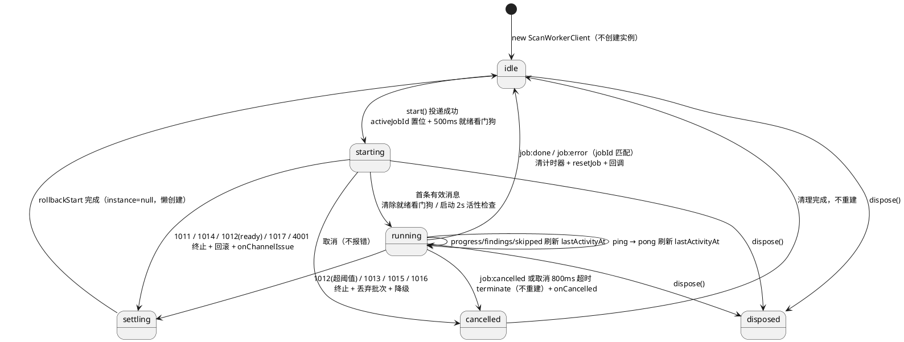
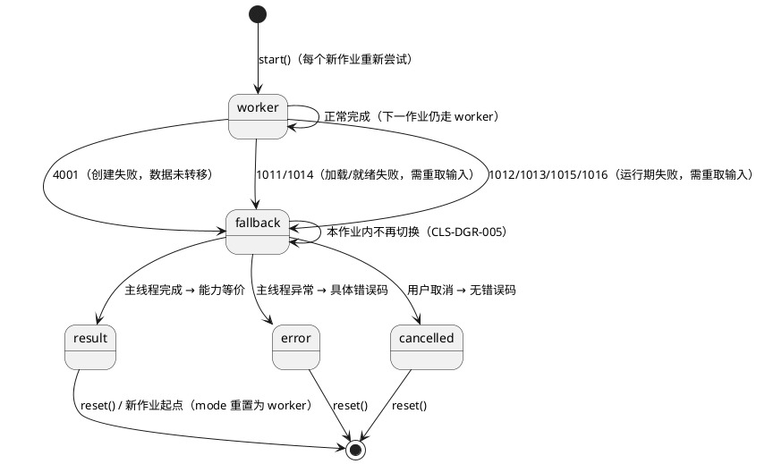
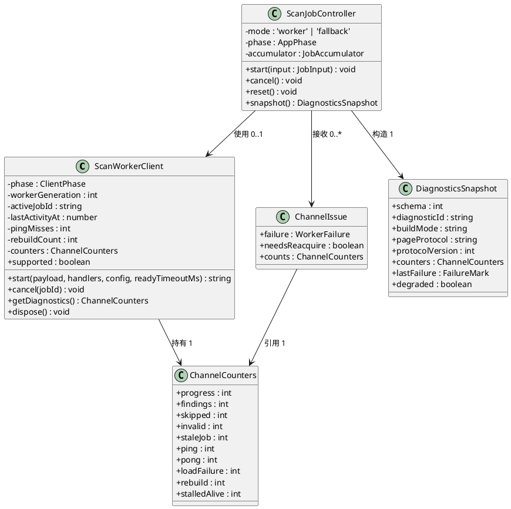
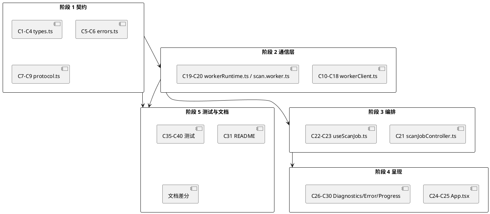

# CommentLeak Scanner 缺陷修复技术方案 · DEF-CLS-E-1008（后台扫描线程通信失败）

> **文档状态**：待评审　**版本**：1.0　**日期**：2026-11-12
> **上游需求**：`defect-cls-e-1008-spec.md`（45 条需求，ACC-19~29）
> **关联既有文档**：`spec.md`（v1.0）、`design.md`（2.6 / 2.8）、`tasks.md`（4.5 / 4.6 / 4.7）
> **本文档范围**：仅设计。不修改任何应用源码、不执行构建。
> **用户已确认决策**：独立错误码（1008 仅兜底）／允许"必须重新上传"但须明示／启动 500ms、运行期 8s／单文件以"自动降级并完成"为通过标准／允许导出不含敏感内容的诊断 JSON／tasks.md 同步修订。

---

# 一、需求与存量功能关系分析

## 1.1 需求功能与存量功能对比

### 1.1.1 已实现功能

| 需求功能 | 存量功能 | 代码位置 | 匹配度 |
|---|---|---|---|
| CLS-WRK-004 部分：作业进行中拒绝并发提交 | `start()` 在 `activeJobId !== null` 时抛错（但错误码误用通信故障码） | `src/workers/workerClient.ts:58-60` | 50% |
| CLS-ERR-006 / CLS-WRK-005 部分：旧作业消息丢弃（进度/命中/跳过/完成/取消） | 分支内 `jobId !== activeJobId` → `return` | `src/workers/workerClient.ts:145-172` | 75% |
| CLS-WRK-008 部分：取消先协作、超时强杀 | `cancel()` → `postMessage(job:cancel)` → 800ms 定时器 → `terminate` → `onCancelled` | `src/workers/workerClient.ts:78-101`；`design.md` 2.6.4 | 75% |
| CLS-DGR-001 部分：无 Worker 环境降级主线程 | `typeof Worker === 'undefined'` → `supported=false` → `runFallback` | `src/ui/hooks/useScanJob.ts:84-100, 227` | 75% |
| CLS-DGR-003 部分：降级路径复用同一扫描实现 | 主线程直接调用 `runJob`，与 Worker 同一份代码 | `src/ui/hooks/useScanJob.ts:166-189`；`src/workers/jobRunner.ts` | 100% |
| CLS-DIA-003：诊断不持久化、不联网 | 无任何 storage / fetch / beacon，`verify-no-network` 静态扫描兜底 | `src/core/log.ts`；`scripts/verify-no-network.mjs` | 100% |
| CLS-PRV-009 部分：错误面板不含堆栈/原始异常 | `WorkerFailure` 仅 4 字段，`ErrorState` 明示不展示原始异常 | `src/types.ts:497-502`；`src/ui/ErrorState.tsx:21-23` | 75% |
| CLS-ERR-001 环境部分：无 Worker 时给出非阻断提示 | 错误目录 `CLS-E-4001` 已存在，`fatal:false` | `src/core/errors.ts:95-100` | 75% |
| 协议结构守卫（字段级） | `isWorkerResponse` 逐类型校验 `protocol`/`jobId`/关键字段 | `src/workers/protocol.ts:108-136` | 75% |
| 协议版本号单一来源 | `PROTOCOL_VERSION = 1`，全部消息类型引用同一常量 | `src/types.ts:106, 528-592` | 100% |
| Worker 双构建工厂 | `@worker-factory` 别名切换 standard / inline 两实现 | `src/workers/factory.standard.ts`、`factory.inline.ts`、`scripts/build.mjs:31-39` | 100% |

### 1.1.2 需要扩展的功能

| 需求功能 | 存量功能 | 差异说明 | 扩展方向 |
|---|---|---|---|
| CLS-ERR-001 七类故障可区分 | 全部通道异常共用一条 `handleWorkerFailure()`，固定回调 `CLS-E-1008` | 输入差异：仅"失败"一个入参，无类别/阶段；输出差异：固定文案；边界差异：不区分"就绪前"与"运行期" | 为 `handleWorkerFailure` 增加归因入参（信号来源 + 阶段 + 是否已有有效消息）；按归因结果查错误目录；保留 1008 仅作 fallback |
| CLS-WRK-001 就绪看门狗 500ms | 无任何启动计时器 | 现状除取消 800ms 外无定时守卫；`design.md` 2.6.5 与 `tasks.md` 4.7 已要求但未实现 | 在 `start()` 内新增 `readyTimer`，首条有效消息/错误信号到达即清除 |
| CLS-WRK-002 运行期活性监控 8s | 无活性时间戳、无心跳 | `job:ping` 请求类型已定义但 Worker 端 `return` 直接丢弃；`design.md` 2.6.2 约定"回 progress"未实现 | 新增 `job:pong` 响应（协议 v2）+ `lastActivityAt` + 周期检查器 |
| CLS-WRK-003 重建有上限、空闲不重建 | `terminateWorker()` 终止后**无条件**重建；失败路径每次都调用 | 无计数、无退避、无"空闲期禁止"守卫 | 改为"懒创建 + 复位"：终止只置 `worker=null`，下次 `start` 才创建；`rebuildCount` 每作业 ≤1 |
| CLS-WRK-004 启动失败回滚 | 先置 `activeJobId` 再 `postMessage`，且未捕获投递异常 | 投递抛错 → 作业状态残留 → 后续提交直接命中并发分支 | 调整置位顺序（投递成功后再置位）+ `try/catch` + 统一 `rollbackStart()` |
| CLS-WRK-005 终态消息校验归属 | `job:error` 分支**不校验 jobId** | 串扰错误会清空并终止当前作业 | 为 `job:error` 增加 `jobId === activeJobId` 守卫 |
| CLS-WRK-006 非法消息可观测计数 | 守卫失败 → `return`，无计数 | 界面可能永久"扫描中" | 新增 `ChannelCounters.invalid` 与最近非法类别，进入诊断快照 |
| CLS-WRK-010 可用性以"有效往返"判定 | 构造成功即 `supported=true` | 构造成功但脚本不执行时仍被判为可用 | 以"首条有效消息"作为 `available` 的判定依据 |
| CLS-DGR-001/004 降级覆盖面与提示形态 | 仅覆盖 `typeof Worker === 'undefined'` 与工厂抛错；降级提示为固定 4001 文案 | 未覆盖脚本加载失败、就绪超时、运行期无响应；提示无法区分原因 | 统一 `degrade()` 入口 + 四类触发点 + 单槽提示条（原因码 + 阶段 + 建议） |
| CLS-DGR-002 降级路径失败可见 | `runFallback` 内 `await runJob` **无 try/catch**（`src/ui/hooks/useScanJob.ts:176`） | 主线程异常 → 未处理拒绝 → 永久"扫描中"/白屏 | 包 `try/catch`，转 `toErrorInfo` 具体错误码 |
| CLS-DGR-005 作业内不抖动 | `degraded` 只是展示状态，无"本作业最终决策"语义 | 每次 `start` 都尝试 Worker，无作业级锁定 | 引入 `mode: 'worker' | 'fallback'`（作业级），降级即锁定到本作业结束 |
| CLS-DIA-001/002 诊断快照 | 无诊断模型；`result.diagnostics` 是"扫描期文件诊断"，与通道无关 | 语义不同，不可复用 | 新增独立 `DiagnosticsSnapshot`（白名单字段）+ 错误/降级两处入口 |
| CLS-ERR-007 并发冲突语义化 | 抛 `ClsError('CLS-E-1008')` | 非故障被当作故障 | 新增状态类错误码，UI 以警告而非致命面板呈现 |

### 1.1.3 需要新增的功能或接口

**A. 通道状态与归因（`src/workers/workerClient.ts`）**

1. `ScanWorkerClient.getDiagnostics()`：输出 `ChannelCounters`（progress/findings/skipped/invalid/staleJob/ping/pong/loadFailure/rebuild），输入无，输出只读快照；核心逻辑为读取内部计数器并附带 `lastFailure`。
2. `ScanWorkerClient.start()` 增加 `readyTimeoutMs` 可注入参数（默认 500ms），便于测试注入，不改变线上默认行为。
3. `ScanHandlers.onChannelIssue(issue)`：与 `onError` 并列的新回调；输入 `ChannelIssue`（失败报告 + 是否已恢复 + 是否需要重取输入），输出为上层编排决策；依赖 `WorkerFailure` 扩展。
4. `ScanWorkerClient.setLivenessPolicy(policy)`：接受 `{ intervalMs: 2000, quietMs: 8000, unzipQuietMs: 12000, maxPingMisses: 3 }`；便于测试与后续调参，运行时使用默认值。

**B. 协议扩展（`src/workers/protocol.ts`、`src/workers/scan.worker.ts`）**

1. `classifyInbound(value: unknown): InboundClassification`：输入任意通道载荷，输出 `{ kind: 'valid'|'protocol-mismatch'|'invalid'|'foreign-job', type: string|null, detail: string }`；替代"先 mismatch 再 guard 再逐分支 jobId"的分散判定，判定顺序集中为单一函数（CLS-NFR-036 单一来源）。
2. `job:pong` 响应消息（Worker → 主线程），载荷 `{ protocol, type:'job:pong', jobId, phase }`；用于运行期活性确认。
3. `src/workers/workerRuntime.ts`（新增）：把 `scan.worker.ts` 内联的消息绑定与异常上报抽为 `createWorkerRuntime(scope)`，使 ping/pong 与内部异常上报可在 Node 环境测试（CLS-NFR-037/038）。

**C. 降级编排（`src/ui/hooks/scanJobController.ts` 新增，`useScanJob.ts` 收窄为 React 桥接）**

1. `ScanJobController.start(input: JobInput)`：`JobInput = { payload, acquire?: () => Promise<StartPayload> }`；`acquire` 用于 zip 字节被转移后重新取得输入（App 用保留的 `File` 句柄重新 `arrayBuffer()`）。
2. `ScanJobController.degrade(reason: ChannelIssue)`：单一降级入口，内部保证"幂等 + 作业内只执行一次"。
3. `ScanJobController.snapshot()`：返回诊断快照模型（供 UI 展示/导出）。

**D. 诊断与 UI（`src/core/diagnostics.ts`、`src/ui/DiagnosticsPanel.tsx` 新增）**

1. `buildDiagnosticsSnapshot(input): DiagnosticsSnapshot`：白名单构造，禁止透传原始对象。
2. `createDiagnosticId(random, now): string`：本地诊断编号，不含 `jobId`。
3. `serializeDiagnostics(snapshot): string`：稳定键序 JSON（≤40 行）。
4. `DiagnosticsPanel`：`<details>` 展开 + "复制" + "导出 JSON"；依赖 `export.ts` 的 `downloadTextFile` / `copyTextToClipboard`。

## 1.2 存量功能详细分析

### 1.2.1 `ScanWorkerClient`（`src/workers/workerClient.ts`）

| 维度 | 现状 | 对本修复的约束 |
|---|---|---|
| 接口契约 | `supported`（getter）、`start(payload, handlers, config): string`、`cancel(jobId)`、`dispose()` | 新增能力必须向后兼容这三处调用点；`start` 的返回 `jobId` 契约保留，抛错语义改为携带类别 |
| 构造副作用 | 构造函数内直接 `factory()` 创建实例并绑定监听器（`39-47`） | 构造发生在 `useScanJob` 的 `useEffect` 中，早于任何作业；若构造失败会永久 `supported=false`，与"新作业可重试"（CLS-DGR-005）冲突 → 必须改为懒创建 |
| 失败出口 | `handleWorkerFailure()`（`179-189`）无条件 `terminate + resetJob + onError(1008)` | 单一出口是"归因架构缺陷"的根；重构后任何失败出口都不得绕过归因函数 |
| 终止副作用 | `terminateWorker()`（`191-205`）终止后立即 `tryCreateWorker()` | 空闲期重建、失败循环重建的直接原因；且重建发生在 `dispose()` 路径上（销毁后仍创建新实例）→ 必须拆分为 `terminate()` 与 `ensureWorker()` |
| 消息路由 | `handleMessage()` 先 `isProtocolMismatch` 再 `isWorkerResponse`，随后各分支自行校验 `jobId` | 校验分散、错误类别不可区分；`job:error` 分支缺失 `jobId` 校验（`163-167`） |
| 并发控制 | `activeJobId !== null` 抛 `CLS-E-1008` | 语义错误，需替换为状态类错误码 |
| 计时器 | 仅 `cancelTimer`（800ms） | 无就绪/活性计时器；新增定时器必须在 `dispose()` 与终态路径全部清理 |
| 约束 | 主线程侧不得读取条目正文、不得操作 DOM；所有回调同步 | 归因逻辑必须是纯同步计算，不得引入 `await`（保证 `onerror` 回调内的处置顺序确定） |

### 1.2.2 `protocol.ts` 与 `scan.worker.ts`

| 维度 | 现状 | 约束与扩展点 |
|---|---|---|
| `isWorkerResponse` | 只校验 `protocol === PROTOCOL_VERSION`；`job:error` 仅校验 `failure.code` 为字符串 | 扩展点为"返回分类而非布尔"；需保留布尔版本供既有调用（`control.ts` 无其他调用方，`scan.worker` 用 `isWorkerRequest`） |
| `isProtocolMismatch` | 任意对象且 `protocol !== 1`（含 `protocol` 缺失的对象） | 会把"完全无关对象"误判为版本不匹配 → 必须收紧为"含 `type` 字段且显式携带 `protocol`" |
| `job:ping` | 请求类型与构造器 `createPingRequest` 已存在（`protocol.ts:64-70`），Worker 端 `return`（`scan.worker.ts:28-30`） | 服务端应答缺失；新增 `job:pong` 即可闭环，无需新请求类型 |
| Worker 端异常 | `runJob` 内部 `catch` 已把业务错误转为 `job:error`；`self.onerror` 未设置 | 引擎内未捕获异常（异步拒绝、顶层语法错误除外）无上报；需新增 `self.onerror` 与 `unhandledrejection` 等价保护 |
| 单活动作业 | 新 `job:start` 先 `cancel` 旧作业（`32-33`） | 与主线程并发拒绝策略重复，但不冲突；保留作为引擎侧兜底 |

### 1.2.3 降级路径（`useScanJob.ts`）

| 维度 | 现状 | 约束 |
|---|---|---|
| 触发面 | 仅 `!client.supported` 与 `start` 抛 `CLS-E-4001` | 覆盖面不足（缺加载失败/就绪超时/运行期无响应） |
| 数据可获得性 | `handleZip` 在 `App.tsx:97` 取 `file.arrayBuffer()` 后放入 `payload.data`；`workerClient.start` 以 Transferable 转移（`workerClient.ts:73-74`） | 转移后主线程 `byteLength === 0`；`openZipArchive` 对 0 字节直接抛 `CLS-E-1006`（`src/core/unzip.ts:232-234`）→ 降级必须重新取得字节 |
| 错误处理 | `void runFallback(...)`（`218`、`227`），内部无 `try/catch` | 主线程异常将成为未处理拒绝；必须捕获并转错误态 |
| 取消 | `cancelRef.current?.cancel()` 仅对降级信号生效；Worker 路径走 `client.cancel` | 降级/Worker 两条取消路径需统一到 `mode` 判定 |
| 状态 | `degraded` 布尔、`error`、`activeJobId` | 需新增 `channelIssue`（非阻断）与 `mode`（作业级），并保证同一作业只渲染一个通道提示 |

### 1.2.4 构建链路（`scripts/build.mjs`、`factory.*.ts`）

| 事实 | 影响 |
|---|---|
| 标准构建 `worker.format: 'iife'`（`build.mjs:69-72`），产物为独立 `assets/scan.worker-<hash>.js` | 资源 404 / 旧页面 + 新 hash / MIME 错误 → 触发 `onerror`（加载失败类） |
| 单文件构建以 `?worker&inline` 生成 Blob URL，失败回退 `data:` 并立即 `revokeObjectURL` | 浏览器策略可能同时拒绝两者；立即撤销存在竞态 → 应以"500ms 内是否有有效消息"为最终判据，而非构造是否成功 |
| `vite-plugin-typescript.mjs` 用 `ts.transpileModule` 替代 esbuild | 新增文件（`workerRuntime.ts`、`diagnostics.ts`）无需改构建配置；`worker.plugins` 已包含同一转换插件（`build.mjs:71`），Worker 子构建可正常编译新文件 |
| `verify-build.mjs` 仅检查 HTML 含 `Blob|worker` 关键字 | 静态校验无法证明"能构造且能执行"；本修复以测试 + 浏览器验收补足（CLS-NFR-038） |

## 1.3 缺陷根因 → 需求 → 设计章节映射

| 根因编号（spec 附录 A） | 现象 | 对应需求 | 本设计落点 |
|---|---|---|---|
| P-01 单一故障出口 | 任何故障都显示 1008 | CLS-ERR-001/008 | 2.1、2.2 |
| P-02 `onerror` 混淆加载失败与运行期崩溃 | 无法区分原因 | CLS-ERR-001/003 | 2.2（阶段 + 有效消息数判定） |
| P-03 `onmessageerror` 归为通信失败 | 解析失败不可见类别 | CLS-ERR-004 | 2.1、2.2 |
| P-04 协议不匹配归为通信失败 | 版本问题被误报 | CLS-ERR-005 | 2.1、2.7（协议 v2） |
| P-05 并发复用 1008 | 重复提交报通信故障 | CLS-ERR-007 | 2.1（1018）、2.3 |
| P-06 `failureFrom` 统一转文案 | 无法携带阶段 | CLS-ERR-009 | 2.7（`WorkerFailure` 扩展） |
| P-07 非法消息静默丢弃 | 永久"扫描中" | CLS-ERR-004、CLS-WRK-006 | 2.2、2.6 |
| P-08 串扰无计数 | 无诊断依据 | CLS-ERR-006、CLS-WRK-005 | 2.2、2.6 |
| P-09 `job:error` 不校验 jobId | 当前作业被误终止 | CLS-WRK-005 | 2.2（判定顺序第 3 步） |
| P-10 `job:done` 无配置即 return | 永久"扫描中" | CLS-DGR-002 | 2.3（终态清理契约） |
| P-11 `job:ping` 无应答 | 无法判断活性 | CLS-WRK-002/010 | 2.5 |
| P-12 无条件重建 | 空转与抖动 | CLS-WRK-003 | 2.3（懒创建 + 上限 1） |
| P-13 先置位后投递、未捕获 | 状态残留 | CLS-WRK-004 | 2.3（置位顺序） |
| P-14 取消触发重建 | 空闲重建 | CLS-WRK-003/008 | 2.3 |
| P-15 降级无 try/catch | 白屏/永久扫描中 | CLS-DGR-002 | 2.3、2.4 |
| P-16 构造即视为可用 | 假阳性可用性 | CLS-WRK-010 | 2.2、2.5 |
| P-17~P-21 构建/产物侧 | 加载失败不可归因 | CLS-ERR-003、CLS-NFR-039/040 | 2.4、2.5、5.1 |
| P-22 通信层零测试 | 99 条测试全过仍失败 | CLS-NFR-037/038 | 4.1 |
| P-23 500ms 降级守卫未实现 | 设计已定、实现缺失 | CLS-WRK-001 | 2.5 |
---

# 二、增量设计方案

## 2.1 错误码分配

### 2.1.1 分配原则

1. **一类一码**：每个故障类别对应且仅对应一个错误码；`WorkerFailure.category` 与错误码双向唯一（CLS-NFR-036）。映射表由 `src/core/errors.ts` 的 `CHANNEL_CATALOG` 单一维护，`workerClient` 只允许"按类别查码"，禁止硬编码字面量。
2. **不复用、不改义**：既有 `CLS-E-1001 ~ 1010`、`2001/2002`、`3001/3002`、`4001` 的语义一律不改；通道类新增占用 `1011 ~ 1018`（与既有编号无冲突，且留出 `1019 ~ 1020` 作为后续扩展余量）。
3. **1008 只兜底**：仅在归因函数返回 `unclassified` 时使用；任何可判定路径不得回落到 1008。1008 条目升级为"必须携带阶段 + 通道状态短语"（CLS-ERR-008）。
4. **降级类一律非阻断**：凡"已自动降级并继续"的类别，`fatal = false`、`recovered = true`，UI 渲染为琥珀色内联条而非红色错误面板。
5. **引擎上报错误原样透传**：`job:error` 携带的 `failure.code` 若属于既有业务目录（1001~1010、2001/2002），直接呈现，不再二次包装为通道码。

### 2.1.2 错误码分配表

| 错误码 | 类别 `category` | 含义 | 触发条件（判定依据） | 用户文案（message） | 建议动作（hint，≥1 条且针对性） | 可降级 | 致命 `fatal` | 可重试 `retryable` |
|---|---|---|---|---|---|---|---|---|
| `CLS-E-1011` **新增** | `load` 加载失败 | 后台扫描引擎脚本未能加载 | 作业启动后 `worker.onerror` 到达，且该作业**尚未收到任何有效消息**（阶段 = `ready`） | 后台扫描引擎未能加载，已切换为主线程处理。 | ①刷新页面以更新引擎资源；②确认构建文件完整（标准构建检查 `assets/` 下的引擎文件）；③若为单文件版，可尝试改用标准构建；④关闭可能拦截脚本的浏览器扩展后重试 | 是 | 否 | `refresh`（降级已完成，无需立即重试） |
| `CLS-E-1012` **新增** | `parse` 消息解析失败 | 扫描结果传输异常 | ①`worker.onmessageerror`；②`classifyInbound` 返回 `invalid`（结构不符/关键字段类型错误/未知 `type`）；③非法消息累计 ≥ 阈值且期间无有效消息 | 扫描结果传输异常，可重新尝试。 | ①点击"重新尝试"重跑本作业；②若反复出现，刷新页面以更新引擎；③展开诊断信息并反馈非法消息计数 | 是（输入可重取时） | 否 | `retry` |
| `CLS-E-1013` **新增** | `protocol` 协议版本不匹配 | 页面与后台扫描引擎版本不一致 | 收到 `type` 为已知响应类型、显式携带 `protocol` 且 `protocol !== PROTOCOL_VERSION` 的对象 | 页面与后台扫描引擎版本不一致，请刷新页面以更新。 | ①刷新页面（Ctrl/Cmd+Shift+R 绕过缓存）；②刷新后重试同一文件；③若仍不一致，重新构建并部署整套产物（页面与引擎必须同源同版） | 是（条件性，需重取输入） | 否 | `refresh` |
| `CLS-E-1014` **新增** | `timeout` 就绪超时 | 后台引擎未在启动窗口内响应 | `job:start` 投递成功后 **500ms** 内：无任何有效消息、无 `onerror`、无取消请求 | 后台扫描引擎未响应，已切换为主线程处理。 | ①无需操作，扫描已继续（大文件处理时页面可能短暂卡顿）；②若反复出现，刷新页面以更新引擎；③确认浏览器未限制本页面的脚本执行 | 是 | 否 | `none`（已自动恢复） |
| `CLS-E-1015` **新增** | `timeout` 运行期无响应 | 后台引擎在扫描过程中停止响应 | 运行期连续 **8s**（解压阶段 12s）无任何活性（progress/findings/skipped/pong 均无），且 ping 连续 3 次无应答 | 后台扫描引擎已停止响应，已切换为主线程继续扫描。 | ①无需操作，扫描已在主线程继续；②大文件结束后可再次尝试（新的扫描会重新使用后台引擎）；③若反复出现，展开诊断信息反馈消息计数 | 是 | 否 | `none`（已自动恢复） |
| `CLS-E-1016` **新增** | `engine` 引擎内部异常 | 后台引擎运行中出现未捕获异常 | 该作业**已收到过有效消息**后 `worker.onerror` 到达；或 Worker 端 `self.onerror`/`unhandledrejection` 上报 | 后台扫描引擎运行异常，已切换为主线程重新扫描。 | ①无需操作，扫描将重跑一次（主线程）；②若特定压缩包反复触发，拆分后分批扫描；③展开诊断信息并反馈阶段与计数 | 是 | 否 | `none`（已自动恢复） |
| `CLS-E-1017` **新增** | `delivery` 消息投递失败 | 作业无法投递给后台引擎 | `worker.postMessage(job:start)` 同步抛错（数据不可克隆、缓冲区已分离、Worker 已终止） | 扫描任务无法发送到后台引擎。 | ①点击"重新上传"重试（若压缩包数据已被占用，需要重新选择文件）；②改用标准构建（`http` 方式打开）；③若反复出现，展开诊断信息反馈 | 是（需重取输入，否则提示重新上传） | 否 | `reupload` |
| `CLS-E-1018` **新增** | `concurrency` 并发冲突 | 已有扫描正在进行 | 调用 `start()` 时 `activeJobId !== null`（含 `validating`/`scanning` 期间重复提交） | 已有扫描正在进行，请等待完成或先取消。 | ①等待当前扫描完成；②或点击"取消扫描"后再重新提交；③不要重复点击开始按钮 | 否（不进入降级） | 否 | `none` |
| `CLS-E-1008` 既有（语义收紧为兜底） | `unclassified` 无法归类 | 后台扫描通道异常（未能归因） | 归因函数穷尽所有分支后仍无法归类；或异常信号与当前状态无法自洽（例如无活动作业时收到终态错误） | 后台扫描通道异常（未能归因）。 | ①重新上传后重试；②刷新页面以更新页面与引擎；③展开诊断信息并反馈，附错误码与诊断编号 | 视输入可获得性而定 | 是 | `reupload` |
| `CLS-E-4001` 既有（复用为创建失败） | `construct` 创建失败 | 后台扫描不可用，已降级主线程 | ①`typeof Worker === 'undefined'`；②`factory()` 抛错（安全策略/扩展拦截/构造异常）；③`ensureWorker()` 返回空 | 当前浏览器不支持后台扫描，已降级为主线程处理。 | ①无需操作，全流程功能仍可用；②处理大文件时页面可能短暂卡顿；③标准构建经 `http(s)` 打开，单文件版可尝试另一构建 | 是（数据尚未转移，可直接同作业降级） | 否 | `none` |
| `CLS-E-1001 ~ 1010`、`2001/2002` 既有 | 透传 | 业务错误（压缩包损坏/加密/炸弹/空输入等） | Worker `job:error` 上报（`jobId` 与活动作业一致） | 保持既有文案 | 保持既有建议 | 否 | 依既有目录 | 依既有目录 |

**说明**

- "可降级"列中的**条件性**：`1012/1013/1016/1017` 发生时 zip 字节可能已被结构性克隆/转移，主线程无法复用原 `ArrayBuffer`；此时由 `JobInput.acquire` 重新取得输入（见 2.4.3），取不到则按用户决策 2 明示"需要重新上传"。
- `1011/1013/1014/1015/1016` 全部 `fatal:false` 且 `recovered:true`，因此**不进入** `ErrorState` 红色面板，只进入"通道提示条"（单槽）。
- 错误码总数新增 8 个；`fatal:true` 的通道码只剩 `CLS-E-1008`，用户不会再看到"任何故障都是同一句提示"。

## 2.2 归因判定算法

### 2.2.1 判定输入与状态前提

归因函数为纯同步函数，签名契约：

```
type FailureSignal =
  | { kind: 'construct-failed'; cause: 'unsupported' | 'throw' }
  | { kind: 'worker-error'; hadValidMessage: boolean; phase: ChannelPhase }
  | { kind: 'message-error' }
  | { kind: 'invalid-message'; detail: string }
  | { kind: 'protocol-mismatch'; received: number }
  | { kind: 'delivery-failed'; cause: 'clone' | 'detached' | 'terminated' }
  | { kind: 'ready-timeout' }
  | { kind: 'liveness-timeout'; quietMs: number; pingMisses: number }
  | { kind: 'engine-reported'; jobId: string; failure: WorkerFailure }
  // 注：v1 的 job:error 消息没有顶层 jobId（仅 failure），无法校验归属（P-09 根因），
  //     v2 必须补齐顶层 jobId（见 2.7.3 与 C34）。
  | { kind: 'unknown'; detail: string };

interface AttributionContext {
  readonly activeJobId: string | null;
  readonly cancelRequested: boolean;
  readonly acceptedMessages: number;   // 本作业已接受的有效消息数
  readonly phase: ChannelPhase;        // create|load|ready|running|finalize
  readonly workerGeneration: number;
}
```

其中 `ChannelPhase` 取值：`create`（构造）、`load`（脚本加载/尚未首条消息）、`ready`（已投递等待首条）、`running`（已收到首条有效消息）、`finalize`（已收到终态）。

### 2.2.2 判定顺序（严格有序，命中即返回）

判定顺序按"证据强度"排列：状态类证据 > 数据类证据 > 时序类证据 > 兜底。

| 顺序 | 守卫条件 | 归因结果 | 处置 | 说明 |
|---|---|---|---|---|
| 1 | `cancelRequested === true` | **不入库**（返回 `cancelled`） | 仅完成取消收尾：清除所有定时器、`terminate`（不复位重建）、`onCancelled` | 取消是正常结果（CLS-WRK-008）；取消期任何 `onerror/超时` 一律抑制 |
| 2 | `activeJobId === null && signal.kind !== 'construct-failed'` | **不入库**（返回 `idle-ignored`） | 仅 `counters.idleSignals += 1`，不提示、不重建 | 空闲期失败只计数（CLS-WRK-003 附录场景表） |
| 3 | 信号为 `engine-reported` 且**消息顶层 `jobId`** 缺失或不等于 `activeJobId` | **不入库**（返回 `stale`） | `counters.staleJob += 1`，丢弃；状态不变 | 修复 P-09；`job:error` 必须校验归属（CLS-WRK-005）。协议 v2 为该消息补齐顶层 `jobId` |
| 4 | 信号为 `engine-reported` 且顶层 `jobId` 匹配 | `engine-reported`（透传 `failure.code`） | 终态：清定时器 → `resetJob` → `onError(failure)` | 引擎已给出结构化原因，优先级最高，不做二次归类 |
| 5 | `signal.kind === 'construct-failed'` | `construct` → `CLS-E-4001` | 不创建实例；由上层同作业降级（数据未转移，可直接复用 `payload`） | 创建阶段无定时器、无并发歧义 |
| 6 | `signal.kind === 'delivery-failed'` | `delivery` → `CLS-E-1017` | `rollbackStart()`（`activeJobId=null`、清定时器、`handlers=null`），`onChannelIssue`（`needsReacquire=true`） | 投递失败先于加载判定：实例存在但未收到任务 |
| 7 | `signal.kind === 'protocol-mismatch'` | `protocol` → `CLS-E-1013` | 停用该引擎：清定时器 → `terminate` → `rollbackStart()` → `onChannelIssue` | 版本信号强度高于结构信号（旧版消息必然字段不同） |
| 8 | `signal.kind === 'message-error'` | `parse` → `CLS-E-1012` | 阶段分支：`ready` 阶段 → 终止并降级；`running` 阶段 → 记录 + 单槽提示，**不终止**（等待后续有效消息或超时升级） | `onmessageerror` 只说明该条不可解码，不等于引擎已死 |
| 9 | `signal.kind === 'invalid-message'` | `invalid`（不直接定类别） | `counters.invalid += 1`；若处于 `ready` 阶段且无有效消息 → 升级为 `1012` 并降级；若处于 `running` → 仅更新单槽提示 | 连续 50 条非法消息：首次提示一次，计数 50（CLS-ERR-004 验收） |
| 10 | `signal.kind === 'worker-error' && acceptedMessages === 0` | `load` → `CLS-E-1011` | 终止 → **不重建** → `rollbackStart()` → 降级 | 修复 P-02：零有效消息时的 `onerror` 是加载/解析/拦截，而非运行期崩溃 |
| 11 | `signal.kind === 'worker-error' && acceptedMessages > 0` | `engine` → `CLS-E-1016` | 终止 → 丢弃本作业已收批次 → 降级重跑（`needsReacquire`） | 运行期崩溃：重建无意义（输入已转移），直接降级 |
| 12 | `signal.kind === 'ready-timeout'` | `timeout/ready` → `CLS-E-1014` | 终止（不重建）→ `rollbackStart()` → 降级 | 修复 P-16/P-23 |
| 13 | `signal.kind === 'liveness-timeout'` | `timeout/running` → `CLS-E-1015` | 终止 → 丢弃已收批次 → 降级重跑 | 判定条件见 2.5 |
| 14 | `signal.kind === 'unknown'` | `unclassified` → `CLS-E-1008` | 终止 → `rollbackStart()` → 按 `needsReacquire` 给提示 | 唯一允许出现 1008 的路径 |

### 2.2.3 同一事件多因时的优先级

单个浏览器事件可能同时满足多个条件，按下列优先级**单向**收敛（不回溯、不叠加）：

1. **谁先产生不可逆动作，谁优先**：`engine-reported` 与 `cancelRequested` 优先级最高，因为它们代表"引擎/用户已经决定结局"。
2. **状态类 > 数据类**：`idle-ignored` / `stale` 先于一切类别判定；串扰永不算故障（CLS-ERR-006）。
3. **投递 > 创建 > 加载**：投递失败已证明实例可用；创建失败已证明实例不存在；`onerror` 需要"有效消息数"来区分加载与运行期。
4. **版本 > 结构**：同一对象既 `protocol` 不符又结构不符时，报 1013 而非 1012（提示必须指向"刷新"，否则用户永远重试失败）。
5. **超时是最后手段**：`ready-timeout` 只在无错误信号、无有效消息时生效；若 500ms 定时器触发前 1ms 收到 `onerror`，以 `onerror` 归因为准（定时器回调内先复查 `acceptedMessages > 0 || failureSettled`）。

### 2.2.4 去重与"只提示一次"

| 机制 | 规则 | 覆盖需求 |
|---|---|---|
| `failureSettled` | 每次"降级/终态"置位；置位后所有同源信号（含 `terminate` 引发的迟到事件、旧 generation 的消息）直接丢弃 | CLS-WRK-007、CLS-NFR-035 |
| `reportedCategories: Set<Category>` | 同一作业内同类别只允许一次"用户可见呈现"；再次发生只累加 `counters` | CLS-WRK-007（同类 5 次 → 1 条提示、计数 5） |
| `channelIssueSlot`（单槽） | UI 侧只渲染 1 个通道提示条；升级（如 `invalid` → `timeout/ready`）时**替换**同一槽位的码与文案，不新增第二条 | CLS-NFR-035、CLS-ERR-004 |
| `generation` 守卫 | 每次 `terminate`/重建 `workerGeneration += 1`；监听器闭包捕获创建时的 generation，代次不符即忽略 | 旧实例污染，防"取消后旧消息复活" |
| `staleJob` 计数 | `jobId` 不匹配只计数，不提示、不改变状态 | CLS-ERR-006、CLS-WRK-005 |
| 提示优先级 | 同槽位替换优先级：`取消 > 运行期无响应 > 就绪超时 > 加载失败 > 协议不匹配 > 解析失败 > 兜底` | 避免"轻故障覆盖重故障" |

### 2.2.5 非法消息阈值

| 阶段 | 单条非法消息 | 连续非法（无有效消息） |
|---|---|---|
| `ready`（首条有效消息前） | 立即归因 `1012` 并降级（引擎未正确通信） | 同左 |
| `running` | 计数 + 单槽提示（可重试），不终止 | 连续 ≥5 条且期间无有效消息 → 归因 `1012` 并降级 |
| 终态后 | 计数，丢弃 | 同左 |

## 2.3 状态机与生命周期改造

### 2.3.1 `ScanWorkerClient` 内部状态

| 字段 | 类型/取值 | 置位/清理时机 | 作用 |
|---|---|---|---|
| `phase` | `idle / starting / running / settling / disposed` | `start` → `starting`；首条有效消息 → `running`；终态处置 → `settling` → `idle`；`dispose` → `disposed` | 防止跨阶段误判 |
| `worker` | `Worker \| null` | **懒创建**：仅 `start()` 内 `ensureWorker()`；`terminate()` 后置 `null`，不立即重建 | 修复 P-12/P-14 |
| `workerGeneration` | 递增整数 | 每次 `ensureWorker()` 成功 +1 | 旧实例事件隔离 |
| `activeJobId` | `string \| null` | **`postMessage` 成功返回之后**置位（见 2.3.2） | 消除"投递失败即残留"（P-13） |
| `handlers` | `ScanHandlers \| null` | 与 `activeJobId` 同生命周期 | 保证无活动作业时无回调 |
| `readyTimer` | `number \| null`（500ms） | 投递成功后启动；首条有效消息 / 任一归因 / 取消 / `dispose` 清除 | 启动看门狗 |
| `livenessTimer` | `number \| null`（周期 2s） | 首条有效消息后启动；终态/取消/`dispose` 清除 | 运行期看门狗 |
| `lastActivityAt` | 单调时钟毫秒 | 首条有效消息、每次 `progress/findings/skipped/pong` 更新 | 活性基准 |
| `pingMisses` | 整数 | `ping` 发出后收到 `pong` 归零；超过 3 次判定无响应 | 区分"忙"与"死" |
| `rebuildCount` | 整数（每作业 ≤1） | `buildOrReset` 发生重建 +1；新作业重置 | 满足 CLS-WRK-003 |
| `cancelRequested` / `cancelTimer` | 布尔 / `number \| null` | `cancel()` 置位并启动 800ms；`onCancelled` 清 | 取消抑制归因（P-14） |
| `counters` | `ChannelCounters` | 只增不清（作业级累加，`reset()` 保留诊断） | 诊断快照 |
| `failureSettled` / `reportedCategories` | 布尔 / `Set` | 作业结束清理 | 去重 |
| `lastFailure` | `{ code, category, phase, at } \| null` | 归因时写入 | 诊断/UI |

### 2.3.2 `activeJobId` 置位时机（关键修正）

```
start(payload, handlers, config):
  1. if (phase !== 'idle' || activeJobId !== null) -> throw ClsError('CLS-E-1018')
  2. if (cancelRequested) -> 先完成取消收尾（幂等）
  3. worker = ensureWorker()                // 失败 -> throw ClsError('CLS-E-4001')（数据未转移）
  4. jobId = newJobId(); request = createStartRequestWithId(jobId, payload, config)
  5. try { worker.postMessage(request, transfer) }   // 唯一可能 detach 的位置
     catch (e) -> { counters.delivery += 1; rollbackStart(); throw ClsError('CLS-E-1017') }
  6. activeJobId = jobId; handlers = handlers; phase = 'starting'
  7. lastActivityAt = now(); startReadyTimer(500ms)
  8. return jobId
```

顺序理由：`postMessage` 的消息处理回调永远在后续事件循环任务中执行，因此"先投递、成功后同步置位"不存在竞态；而先置位会在第 5 步失败时留下 `activeJobId` 残留，正是 P-13 的成因。

### 2.3.3 改造后 `workerClient` 状态图



### 2.3.4 重建策略（上限 1 次、退避、空闲禁止）

| 场景 | 是否重建实例 | 是否重投作业 | 次数约束 | 说明 |
|---|---|---|---|---|
| 取消 800ms 超时 | 否（`terminate` 后置 `null`） | 否 | 0 | 下次 `start` 懒创建（P-14 修复） |
| 加载失败 / 就绪超时 | 否 | 否 | 0 | 同一资源重载几乎必然再失败；直接降级（Q4 结论） |
| 运行期无响应 / 引擎内部异常 | 否 | 否 | 0 | 输入已转移，重投无意义；直接降级 |
| 解析失败（`ready`） | 否 | 否 | 0 | 同上 |
| 主线程降级后 | 否 | 否 | 0 | `mode` 锁定 `fallback`，本作业不切回（CLS-DGR-005） |
| 新作业（上一作业曾失败） | 是（懒创建，+1） | 新 `job:start` | 每作业 ≤1 | 满足"新作业可重试"与"空闲不重建" |

**"重建上限 1 次"的落地口径**：`rebuildCount` 统计"同一作业内由客户端主动调用 `ensureWorker()` 的次数"，上限 1。由于设计选择"失败即降级、不重投"，正常情况下 `rebuildCount` 恒为 0；上限 1 用于约束"未来若开启运行期重试"以及"取消后同作业内重新开始"的极端路径，避免无界重建。空闲期（`activeJobId === null`）**任何路径**都不得调用 `ensureWorker()`；`dispose()` 后 `phase='disposed'`，`ensureWorker()` 直接拒绝。

### 2.3.5 `useScanJob` / `ScanJobController` 状态机

| 状态 `phase` | 含义 | 进入条件 | 离开条件 |
|---|---|---|---|
| `idle` | 无活动作业 | 初始 / `reset()` | `start()` |
| `validating` | 参数与输入校验、尝试后台引擎 | `start()` 且 `mode==='worker'` | 投递成功 → `scanning`；立即降级 → 主线程首条 progress |
| `scanning` | 作业执行中（Worker 或主线程） | 首条有效消息 / 降级开始 | `job:done` → `result`/`empty`；`job:error` → `error`；取消 → `cancelled` |
| `result` / `empty` | 终态（成功） | `job:done` | 新作业 / `reset()` |
| `cancelled` | 终态（用户取消） | `job:cancelled` 或取消超时 | 新作业 / `reset()` |
| `error` | 终态（阻断） | 引擎上报业务错误；降级路径失败且无法归类 | `reset()` |

**作业级模式 `mode`（新增，非 React state，放 controller）**



**终态清理契约**（统一在 controller 的 `settle(kind)`）：

1. 清除 `readyTimer` / `livenessTimer` / `cancelTimer` / 周期检查器；置 `failureSettled = true`。
2. `activeJobId = null`、`handlers = null`、`phase = 'idle'`（client 侧）；`controller.mode` 仅在成功终态时重置，失败终态保留诊断。
3. `job:done` 分支必须校验 `accumulator.config !== null`；若为空（异常时序），不得静默 `return`，而是构造最小错误 `CLS-E-2001` 并进入 `error`（修复 P-10）。
4. 取消终态只回调 `onCancelled`，不写 `error`、不产生错误码（CLS-WRK-008）。
## 2.4 降级设计

### 2.4.1 四个降级触发点

| 触发点 | 归因码 | 数据状态 | 是否需要重新取得输入 | 降级动作 |
|---|---|---|---|---|
| **创建失败** | `CLS-E-4001` | `payload.data` **未转移**（尚未 `postMessage`） | 否 | 直接用原 `payload` 调用 `runFallback`；用户无感 |
| **脚本加载失败** | `CLS-E-1011` | zip 已转移（`byteLength === 0`） | 是（`acquire()`） | 重取输入 → `runFallback`；取不到 → `retryable='reupload'` |
| **就绪超时 500ms** | `CLS-E-1014` | zip 已转移 | 是 | 同上 |
| **运行期无响应 8s / 内部异常** | `CLS-E-1015` / `CLS-E-1016` | zip 已转移，且已收到部分批次 | 是 | 丢弃本作业已收批次（`findings/skipped/rawSnippetStore`）→ 重取输入 → `runFallback` 重跑（保证结果完整、无重复） |

补充：**消息投递失败**（`CLS-E-1017`）按"是否可重取输入"分两种呈现——可重取则与加载失败同路径；不可重取则进入 `retryable='reupload'` 提示，不进入 `fallback`（因为没有任何有效数据可执行）。

### 2.4.2 触发点与阈值的一致性

- 创建失败在 `start()` 内同步判定，早于任何定时器，因此"500ms 就绪看门狗"不会与创建失败叠加提示。
- 加载失败在 `onerror` 到达时立即判定（实测 Chromium 下资源 404 的 `onerror` 通常 <100ms），**不等待** 500ms 定时器；500ms 只是"没有任何信号"的上界（满足 CLS-NFR-029 ≤1s）。
- 运行期无响应的判定由"8s 无活性 + ping 3 次无应答"给出，判定后 ≤1s 内主线程开始产出首条进度（CLS-NFR-029）：`runFallback` 首条 `emitProgress('validating',0,0,null,true)` 是同步 emit，因此实际延迟为"重取输入耗时"（`File.arrayBuffer()`，本地读取，100MB 约 100–300ms）。

### 2.4.3 输入重取（zip 字节已转移的处理）

**设计选择**：App 层保留用户选择的 `File` 引用，提供 `acquire()` 闭包，实现"用户无需重新选择文件"的首选路径；若 `acquire()` 失败（文件被移动/权限失效/无 `File` 引用），按用户决策 2 明示需要重新上传。

```
interface JobInput {
  readonly payload: StartPayload;                       // 首投使用
  readonly acquire?: () => Promise<StartPayload>;       // 降级/重试时重新取得
  readonly label: 'zip' | 'folder';
}
```

`App.handleZip` 的实现要点（不在本阶段编码，仅设计）：

1. 仍然 `const data = await file.arrayBuffer()` 用于首投（保持既有行为），同时把 `file` 保留在闭包中。
2. `acquire = async () => ({ source:'zip', fileName:file.name, sizeBytes:file.size, data: await file.arrayBuffer() })`。
3. `acquire` 结果必须校验 `data.byteLength > 0 && data.byteLength <= LIMITS.maxArchiveBytes`，否则返回失败（不抛原始异常）。
4. 文件夹场景：`StartPayload.folder` 是结构化克隆（`File` 句柄不转移），主线程侧原 `files` 始终可用，`acquire` 直接返回原 payload（**无需重新上传**）。

**提示文案分档**

| 情形 | 提示（单槽，amber） | 按钮 |
|---|---|---|
| 重取成功 | `CLS-E-1011 · 后台扫描引擎未能加载，已切换为主线程处理；大文件时页面可能短暂卡顿。` | 无（无需操作） |
| 重取失败 | `CLS-E-1011 · 后台扫描引擎未能加载，且无法在本地重新读取该压缩包，需要重新上传后继续扫描。` | "重新上传"（打开文件选择，保留已选配置） |

`needsReupload` 时**不进入** `error` 红色面板，上传区保持可用，`phase` 回到 `idle` 并保留一条 `retryable='reupload'` 的提示（CLS-WRK-009：不得因引擎状态永久禁用入口）。

### 2.4.4 主线程降级路径的异常与等价性

**异常保护（修复 P-15）**

```
degrade(issue):
  1. if (mode === 'fallback') return            // 幂等，防抖动
  2. mode = 'fallback'; cancel client 侧作业；重置 accumulator
  3. issue.needsReacquire ? input = await acquire() : input = originalPayload
     - acquire 抛错/超时(5s) -> needsReupload 提示 -> phase='idle' -> return
  4. phase='scanning'; setChannelIssue(issue)（单槽替换）
  5. try { await runJob(startRequest, bridgeEmit, signal) }
     catch (e) { setError(failureFrom(e)); phase='error' }     // 不再有未处理拒绝
  6. 完成/取消/错误由 bridgeEmit 统一走 settle()
```

**能力等价清单（CLS-DGR-003）**：降级路径复用同一 `jobRunner.runJob`，因此 `progress / findings / skipped / done / cancelled / error` 六类消息完全一致；主线程 `emit` 直接调用既有 `handleResponse`，故进度、取消、统计、结果表、跳过清单、脱敏展示、二次确认、JSON/CSV 导出、复制路径九项能力天然等价。**唯一差异**是执行线程，需在 UI 上以 `degraded` 标识呈现（CLS-DGR-004）。

**取消语义**：降级路径 `cancel()` → `cancelRef.current.cancel()` → `runJob` 在下一检查点抛 `CancelledError` → `job:cancelled` → `phase='cancelled'`，≤1s 完成；取消不产生通道错误码。

### 2.4.5 不抖动约束

1. `mode` 为**作业级**变量，降级后本作业内不再调用 `ensureWorker()`；即使后续收到 `progress`（迟到的 Worker 消息）也不切回（`jobId` 与降级作业不同 → 进入 `stale` 计数丢弃）。
2. 同一作业只允许一次"通道提示条"渲染；降级后再发生主线程异常，走红色 `ErrorState`（不同语义：这是执行失败，不是通道故障），不会出现两条通道提示。
3. 新作业 `start()` 时 `mode` 重置为 `worker`，允许重新尝试（CLS-DGR-005 验收口径）；若再次失败，仍走同一降级路径，用户侧表现为"每次降级最多一条提示"。

## 2.5 看门狗实现

### 2.5.1 启动看门狗（500ms）

| 项 | 定义 |
|---|---|
| 计时起点 | `worker.postMessage(job:start, transfer)` **成功返回后**（同步置位 `activeJobId` 的同一时刻） |
| 超时阈值 | 500ms（可注入，默认常量 `READY_TIMEOUT_MS = 500`） |
| 重置/取消条件 | ①收到任意 `jobId === activeJobId` 且结构合法的消息（progress/findings/skipped/done/error/cancelled/pong）；②收到任一归因信号（`onerror`/`onmessageerror`/投递异常）；③用户取消；④`dispose` |
| 到期行为 | 先复查 `acceptedMessages > 0 || failureSettled || cancelRequested`，任一成立则忽略；否则归因 `ready-timeout` → `CLS-E-1014` |
| 不误判论证 | `runJob` 首行即 `emitProgress('validating',0,0,null,true)`（`jobRunner.ts:142`），在 Worker 脚本完成加载与解析后**同步**发出；500ms 覆盖"脚本加载 + 解析 + 首条消息"三段。冷启动 213KB IIFE 解析在低端设备通常 <200ms（ACC-28 连续 3 次验证） |

### 2.5.2 运行期看门狗（8s）

| 项 | 定义 |
|---|---|
| 启动时机 | 首条有效消息被接受后（与清除启动看门狗同一时刻） |
| 计时基准 | `lastActivityAt`（单调时钟），不是固定"总时长"计时器 |
| 刷新条件 | ①`job:progress`；②`job:findings`；③`job:skipped`；④`job:pong`。**终态消息不刷新**（终态直接走 `settle`） |
| 检查方式 | 每 2000ms 检查一次（`setInterval` 语义，用 `setTimeout` 自链式实现以便测试与清理） |
| 判定条件 | `now - lastActivityAt >= quietMs`（默认 8000；`unzipping` 阶段 12000）**且** `pingMisses >= 3` → 归因 `liveness-timeout` → `CLS-E-1015` |
| 存活延长 | 若 8s 无 progress **但** `pong` 正常（`pingMisses === 0`），则**不降级**，记录 `counters.stalledAlive += 1`，并继续等到"硬上限"（连续 3 个静默窗口，即 24s；解压阶段 36s）仍无 progress 才判 1015 |
| 取消/终态 | 立即 `clearTimeout`；`dispose` 幂等清理 |

**心跳协议**

1. 检查器发现 `now - lastActivityAt >= 2000ms` 且 `activeJobId !== null` 且未处于 `settling` → 发送 `job:ping`（同一 `jobId`），`counters.ping += 1`，等待应答。
2. Worker 收到 `job:ping` → 立即 `postMessage({ protocol, type:'job:pong', jobId, phase: activePhase })`；**不改变进度**，不查询解压状态。
3. 主线程收到 `job:pong`（`jobId` 匹配）→ `counters.pong += 1`、`pingMisses = 0`、刷新 `lastActivityAt`。
4. 发 ping 后下次检查前仍未收到 pong → `pingMisses += 1`；连续 3 次（约 6s，叠加 8s 静默窗口）→ 判定无响应。

### 2.5.3 大包解压阶段的误判防护

**风险事实**：`jobRunner` 在 `openZipArchive` → `JSZip.loadAsync` 期间没有 progress 回调（`unzip.ts:236-241`），仅在中央目录遍历结束后才有 `onEntryChecked`。因此 100MB 包存在"一段无 progress 的静默期"。

**三层防护**

| 层 | 机制 | 覆盖场景 |
|---|---|---|
| L1 阶段阈值 | `validating`/`unzipping` 的 `quietMs = 12000`，其余阶段 8000 | 中央目录解析与首轮解压的合法长静默 |
| L2 心跳存活 | 8s 无 progress 但 pong 正常 → 不降级（延长至硬上限） | 解压/正则计算占用事件循环，但停在 `await` 让出点可回 pong |
| L3 硬上限 | 24s（解压阶段 36s）无 progress → 判定 1015，并记录 `stalledAlive` | 真正卡死（既不产出也不应答之上的极端场景） |

**结论**：ACC-28（100MB/5000 条目连续 3 次不误判）由 L1 + L2 共同保证；CLS-WRK-002（≤10s 内判定冻结引擎）由 L2 的"pong 无应答即 8s 判定"保证——两个目标不冲突：**冻结引擎不会回 pong**。

**为什么不用 `design.md` 2.6.2 的"ping 回 progress"**：progress 会污染进度语义（`max(lastPercent, computed)` 单调），且无法在 `unzipping` 阶段表达"我活着但还没解压完"。新增独立 `job:pong` 语义清晰、可计数、可测试。

## 2.6 诊断快照

### 2.6.1 字段白名单（允许导出）

| 字段 | 类型 | 取值 | 来源 |
|---|---|---|---|
| `schema` | 整数 | 固定 `1` | 常量 |
| `diagnosticId` | 字符串 | `diag-<base36 时间>-<4 位随机>` | `createDiagnosticId`（**不含 jobId**） |
| `generatedAt` | ISO 字符串 | 生成时刻 | `new Date().toISOString()` |
| `appVersion` | 字符串 | `__APP_VERSION__` | 构建注入 |
| `buildMode` | 枚举 | `standard` / `single` | `__SINGLE_FILE__` |
| `pageProtocol` | 枚举 | `http` / `https` / `file` | `location.protocol`（**仅协议，不含 host/path**） |
| `engineAvailable` | 布尔 | 当前会话是否成功收到过有效消息 | `workerClient` |
| `engineSource` | 枚举 | `external` / `inline` / `none` | 工厂别名 |
| `protocolVersion` | 整数 | 实际收到的版本（未收到则为 `null`） | `classifyInbound` |
| `protocolExpected` | 整数 | `PROTOCOL_VERSION` | 常量 |
| `counters` | 对象 | `progress / findings / skipped / invalid / staleJob / ping / pong / loadFailure / rebuild / stalledAlive`（非负整数） | `ChannelCounters` |
| `lastFailure` | 对象 \| null | `{ code, category, phase, atMs }`（`atMs` 为相对作业开始的毫秒数，非绝对时间戳） | `lastFailure` |
| `degraded` | 布尔 | 是否已降级 | controller |
| `degradeReason` | 枚举 \| null | 与 `lastFailure.category` 同域 | controller |
| `phase` | 枚举 | `idle/validating/scanning/finalize` | controller |
| `elapsedMs` | 整数 \| null | 作业耗时 | controller |

**序列化约束**：键序固定（按上表顺序），缩进 2 空格，总行数 ≤40（计数合并为一行对象），确保"格式稳定可读"（CLS-DIA-002）。

### 2.6.2 禁止字段清单（构建期断言 + 测试断言）

禁止出现（DOM 文本、剪贴板、导出文件、控制台四处同时约束）：

1. `fileName` / `folderName` / `currentPath` / `filePath` / 任何用户路径（含盘符、`~`、`/home/`）。
2. 注释片段、`rawValue`、`matchedText`、`maskedSnippet`、`snippetText`、`rawSnippet`。
3. 密钥值/令牌/连接串任何形态（含测试夹具中的 `AKIA...`、`Passw0rd` 等）。
4. `error.stack`、原始异常 `message`、异常对象本身（只允许错误码与类别）。
5. 完整 `jobId`（快照中完全不出现；如需关联，仅用 `diagnosticId`）。
6. 引擎脚本完整 URL / `blob:` / `data:` 地址 / 产物 hash 文件名。
7. UA、语言、屏幕尺寸、时区、任何指纹类字段。
8. `ScanConfig` 全量（避免间接暴露用户目录名或规则版本差异）。

**实现约束**：`buildDiagnosticsSnapshot` 只接受 `DiagnosticsInput`（显式字段），**禁止**传入 `WorkerFailure`/`StartPayload`/`ScanResult` 原始对象；提供 `assertSnapshotSafe(snapshot)`（开发期与测试期执行），用正则黑名单自检（`/[A-Za-z]:\\\\|\\/(home|Users)\\//`、密钥前后缀、`stack`、`jobId` 字段名）。

### 2.6.3 导出与 UI 入口

| 项 | 设计 |
|---|---|
| 导出方式 | 复用 `src/core/export.ts` 的 `downloadTextFile(fileName, content, 'application/json;charset=utf-8')`，文件名 `commentleak-diagnostics-<yyyyMMdd-HHmmss>.json`；失败时沿用 `CLS-E-3001`（"下载失败"）文案 |
| 复制方式 | 复用 `copyTextToClipboard`；失败展开只读 `<textarea>`（对齐 `CLS-E-3002` 既有降级） |
| 错误态入口 | `ErrorState` 内新增 `<details>`："查看诊断信息" → `DiagnosticsPanel`（复制/导出） |
| 降级态入口 | 通道提示条右侧"诊断信息"链接 → 同一 `DiagnosticsPanel`（`CLS-DIA-002` 要求错误态与降级态各有入口） |
| 正常完成 | 不展示（CLS-DIA-002 允许不展示；若需保留入口，仅放在页脚"诊断"折叠区，默认不采集额外数据） |
| 组件 | 新增 `src/ui/DiagnosticsPanel.tsx`；`App.tsx` 从 controller 取得 `snapshot()` |
| 隐私 | 面板顶部固定一行："诊断信息仅含运行元数据，不含文件名、路径、片段与密钥。" |

## 2.7 接口设计

### 2.7.1 类型契约（`src/types.ts`）

```
export type ClsErrorCode = ... /* 既有 */ | 'CLS-E-1011' | 'CLS-E-1012' | 'CLS-E-1013'
  | 'CLS-E-1014' | 'CLS-E-1015' | 'CLS-E-1016' | 'CLS-E-1017' | 'CLS-E-1018';

export type ChannelFailureCategory =
  | 'construct' | 'load' | 'parse' | 'protocol' | 'timeout'
  | 'engine' | 'delivery' | 'concurrency' | 'unclassified';

export type ChannelPhase = 'create' | 'load' | 'ready' | 'running' | 'finalize';

export type RetryAction = 'retry' | 'reupload' | 'refresh' | 'none';

export interface WorkerFailure {
  readonly code: ClsErrorCode;
  readonly message: string;
  readonly hint: string;
  readonly fatal: boolean;
  readonly category?: ChannelFailureCategory;   // 新增，可选，通道类必填
  readonly phase?: ChannelPhase;                // 新增，发生阶段
  readonly recovered?: boolean;                 // 新增，是否已降级恢复
  readonly retryable?: RetryAction;             // 新增
  readonly diagnosticId?: string;               // 新增，不含 jobId
}

export interface ChannelCounters {
  readonly progress: number; readonly findings: number; readonly skipped: number;
  readonly invalid: number; readonly staleJob: number; readonly ping: number;
  readonly pong: number; readonly loadFailure: number; readonly rebuild: number;
  readonly stalledAlive: number;
}

export interface ChannelIssue {
  readonly failure: WorkerFailure;              // 必须 fatal:false
  readonly needsReacquire: boolean;
  readonly counts: ChannelCounters;
}

export interface WorkerPongResponse {
  readonly protocol: typeof PROTOCOL_VERSION;
  readonly type: 'job:pong';
  readonly jobId: string;
  readonly phase: ChannelPhase;
}

// 协议 v2 变更：job:error 补齐顶层 jobId（v1 仅有 failure，导致无法校验归属，见 P-09）
export interface WorkerErrorResponse {
  readonly protocol: typeof PROTOCOL_VERSION;
  readonly type: 'job:error';
  readonly jobId: string;
  readonly failure: WorkerFailure;
}
```

**类型安全要求**：`WorkerFailure` 扩展字段全部为可选，既有构造点（`jobRunner.toFailure`、`App` 的 `uploadError`/`exportError`）无需改动即可通过 `tsc --noEmit`；通道类失败由 `workerClient` 统一填充 `category/phase/retryable/recovered`。`ChannelIssue.failure.fatal` 必须为 `false`（编译期无法约束，用 `assertChannelIssue` 在测试中断言）。

### 2.7.2 `ScanHandlers` 扩展

| 方法 | 签名 | 语义 | 不变量 |
|---|---|---|---|
| `onChannelIssue`（新增） | `(issue: ChannelIssue) => void` | 通道故障且已（或即将）降级 | 每作业同类别最多回调一次；`issue.failure.fatal === false` |
| `onError`（语义收紧） | `(failure: WorkerFailure) => void` | 终止性错误（引擎上报业务错误 / 兜底 1008） | 每作业 ≤1 次；与 `onDone`/`onCancelled` 互斥 |
| `onProgress/onFindings/onSkipped/onDone/onCancelled` | 不变 | 业务消息 | `jobId` 已由 client 校验，回调参数可信 |

### 2.7.3 协议升级（v1 → v2）

| 消息 | v1 | v2 | 兼容策略 |
|---|---|---|---|
| `job:start` / `job:cancel` | 有 | 不变 | `PROTOCOL_VERSION` 常量改为 `2`，请求体自动跟随 |
| `job:ping` | 有（Worker 忽略） | Worker 应答 `job:pong` | 新增响应类型 |
| `job:pong` | 无 | 新增 | v1 客户端收到会走 `default` 丢弃，不影响；但本设计将页面与引擎视为同版本 |
| `job:error` | `{ protocol, type, failure }`，无顶层 `jobId` | `{ protocol, type, jobId, failure }` | 修复 P-09：`classifyInbound` 用顶层 `jobId` 判 `foreign-job`，客户端据此丢弃串扰错误 |
| 版本不匹配判定 | `isProtocolMismatch` 过宽 | `classifyInbound` 收紧 | 仅"含已知 `type` + 显式 `protocol` 字段 + 值不等"才判 1013 |

**升级理由**：①心跳需要新消息类型；②`design.md` 2.6.2/`tasks.md` 已把版本写入协议契约，新增消息属于契约变更，按版本纪律必须升版；③升版后"旧缓存引擎 + 新页面"可在首条消息即被识别为 1013，正好满足 ACC-23。

**降级姿态**：`isWorkerResponse` 对未知 `type` 返回 `false`（不改行为）；`classifyInbound` 对未知 `type` 返回 `invalid`，由 2.2.5 阈值决定是否告警。

### 2.7.4 错误目录扩展（`src/core/errors.ts`）

- `ERROR_CATALOG` 新增 8 条（文案见 2.1.2）。
- 新增只读映射 `CHANNEL_CATALOG: Readonly<Record<ChannelFailureCategory, { code: ClsErrorCode; retryable: RetryAction; degradable: boolean }>>`，供归因函数与 UI 共用，杜绝"码 → 类别"散落。
- `CLS-E-1008` 文案改为 `后台扫描通道异常（未能归因）。`，`hint` 至少两条可执行建议；`fatal` 保持 `true`（无以恢复）。
- `CLS-E-4001` 文案保持不变（兼容既有断言），`hint` 追加"若为单文件版，可尝试改用标准构建"。

## 2.8 数据模型

### 2.8.1 类图（通道域）



### 2.8.2 对象生命周期

| 对象 | 创建 | 销毁 | 说明 |
|---|---|---|---|
| `ScanWorkerClient` | `useScanJob` 挂载时（仅实例化，不创建 Worker） | 卸载时 `dispose()` | 实例与 Worker 解耦，是"空闲不重建"的前提 |
| `Worker` | 首次 `start()` 的 `ensureWorker()` | `terminate()` / `dispose()` | 幂等终止；`terminate` 不触发 `onerror` |
| `ChannelCounters` | client 构造 | client 销毁 | 作业级累加；`resetJob` 不清计数（诊断需要历史） |
| `ChannelIssue` | 每次归因（`onChannelIssue` 参数） | 由 controller 决定是否保留（单槽） | 同一作业只保留最后一条 |
| `DiagnosticsSnapshot` | 错误/降级态按需 `snapshot()` | 面板关闭即丢弃，不持久化 | 每次生成新对象，禁止缓存复用 |
| `JobInput` | `start()` 入参 | 作业结束 | 持有 `acquire` 闭包（含 `File` 引用）；作业结束即释放，避免长期持有用户文件句柄 |
---

# 三、代码改动清单

> 只列"文件 → 符号 → 改动 → 依赖"。本阶段不实施。依赖列表示"必须先完成/同步改动"的对象。

## 3.1 类型与错误目录

| # | 文件 | 函数/类型 | 改动说明 | 依赖 |
|---|---|---|---|---|
| C1 | `src/types.ts` | `ClsErrorCode` | 追加 `CLS-E-1011 ~ 1018`（8 个），保持既有 15 个不变 | — |
| C2 | `src/types.ts` | `PROTOCOL_VERSION` | `1` → `2`（`as const` 保留）；所有消息类型通过 `typeof PROTOCOL_VERSION` 自动跟随 | C6、C13 同步 |
| C3 | `src/types.ts` | `WorkerFailure` | 新增可选字段 `category? / phase? / recovered? / retryable? / diagnosticId?`，不破坏既有构造点 | C1 |
| C4 | `src/types.ts` | 新增类型 | `ChannelFailureCategory`、`ChannelPhase`、`RetryAction`、`ChannelCounters`、`ChannelIssue`、`WorkerPongResponse`、`DiagnosticsSnapshot`、`JobInput` | C2、C3 |
| C5 | `src/core/errors.ts` | `ERROR_CATALOG` | 新增 8 条条目（文案见 2.1.2）；`1008` 文案/hint 调整；`4001` hint 追加一条建议 | C1 |
| C6 | `src/core/errors.ts` | `CHANNEL_CATALOG`（新增） | `ChannelFailureCategory → { code, retryable, degradable }` 单一映射；供归因与 UI 共用 | C1、C3 |

## 3.2 通信层

| # | 文件 | 函数/类型 | 改动说明 | 依赖 |
|---|---|---|---|---|
| C7 | `src/workers/protocol.ts` | `classifyInbound(value)`（新增） | 返回 `valid / protocol-mismatch / invalid / foreign-job`，并给出 `type` 与 `detail`；内部复用/收紧 `isWorkerResponse` | C2、C4 |
| C8 | `src/workers/protocol.ts` | `isProtocolMismatch` | 收紧为"`isRecord` + `typeof type === 'string'` + 显式 `protocol` 字段 + 值不等"；避免把无关对象判成版本不匹配 | C7 |
| C9 | `src/workers/protocol.ts` | `isWorkerResponse` | 增加 `job:pong` 分支（`isRecord` + `jobId` 字符串 + `phase` 合法枚举） | C2、C4 |
| C10 | `src/workers/workerClient.ts` | 类字段 | 新增 `phase / workerGeneration / lastActivityAt / pingMisses / readyTimer / livenessTimer / rebuildCount / cancelRequested / counters / failureSettled / reportedCategories / lastFailure` | C3、C4 |
| C11 | `src/workers/workerClient.ts` | 构造函数 / `supported` | 构造只保存 factory，**不创建 Worker**；`supported` 改为 `typeof Worker !== 'undefined'`（环境能力），"是否可用"以 `engineAvailable`（曾收到有效消息）单独表达 | C10 |
| C12 | `src/workers/workerClient.ts` | `start()` | 并发 → `ClsError('CLS-E-1018')`；`ensureWorker()` 失败 → `CLS-E-4001`；`postMessage` 成功后才置 `activeJobId/handlers`；投递异常 → `rollbackStart()` + `CLS-E-1017`；启动 500ms 看门狗；新增可选 `readyTimeoutMs` 参数 | C10、C11、C6 |
| C13 | `src/workers/workerClient.ts` | `handleMessage()` | 改为 `classifyInbound` 单入口；顺序：generation → protocol → shape → jobId；`job:error` 补 `jobId` 校验；`job:pong` 刷新活性；非法/串扰只计数 | C7、C10 |
| C14 | `src/workers/workerClient.ts` | `handleWorkerFailure(signal)` | 由"零参无归因"改为按 2.2.2 归因；输出 `onChannelIssue` 或 `onError`；`failureSettled` 去重 | C6、C10 |
| C15 | `src/workers/workerClient.ts` | `ensureWorker()` / `terminate()` | 拆分为"懒创建"与"幂等终止"；`terminate` 只置 `null` + `generation++`，不重建；`disposed` 后拒绝创建 | C10、C11 |
| C16 | `src/workers/workerClient.ts` | `evaluateLiveness()`（新增） | 2s 周期检查；静默 ≥2s 发 ping；按 2.5.2 判定 1015；维护 `stalledAlive` | C10、C13 |
| C17 | `src/workers/workerClient.ts` | `cancel()` | 置 `cancelRequested`（抑制归因）；800ms 超时 `terminate`（不重建）；`onCancelled`；取消期间丢弃所有故障信号 | C10、C15 |
| C18 | `src/workers/workerClient.ts` | `getDiagnostics()` / `rollbackStart()` / `resetJob()` / `dispose()` | 暴露只读计数；回滚保证 `activeJobId/handlers/phase` 一致；`dispose` 清理全部定时器并拒绝后续创建 | C10 |
| C19 | `src/workers/workerRuntime.ts`（新增） | `createWorkerRuntime(scope)` | 迁出 `scan.worker.ts` 的消息绑定逻辑；实现 `job:ping → job:pong`；`self.onerror` / `unhandledrejection` → 上报 `CLS-E-1016`（有活动作业时）；请求校验失败静默丢弃并计数 | C9、C2 |
| C20 | `src/workers/scan.worker.ts` | 顶层 | 仅保留 `declare const self` + `createWorkerRuntime(self)`，文件瘦身为绑定层 | C19 |
| C34 | `src/workers/jobRunner.ts` | `toFailure` / `job:error` 两处 emit | `job:error` 消息补充顶层 `jobId`（`runJob` 的 `jobId` 变量），业务错误码与文案保持不变；`WorkerFailure` 不新增 `jobId` 字段（避免污染业务错误目录） | C2、C4 |

## 3.3 编排与 UI

| # | 文件 | 函数/类型 | 改动说明 | 依赖 |
|---|---|---|---|---|
| C21 | `src/ui/hooks/scanJobController.ts`（新增） | `ScanJobController` | 从 `useScanJob` 抽出作业编排：`mode`（worker/fallback）、`degrade()` 幂等入口、`runFallback` try/catch、`acquire` 重取输入、终态 `settle()`、`snapshot()`；纯 TS，不依赖 React，可在 Node 测试 | C4、C12、C14、C24 |
| C22 | `src/ui/hooks/useScanJob.ts` | hook 主体 | 收窄为 React 桥接：`useState` 保存 `phase/progress/error/channelIssue/degraded/activeJobId`；`start(payload, acquire?)` 转调 controller；`cancel/reset` 转调；返回 `channelIssue`、`degradedInJob`、`diagnostics` | C21 |
| C23 | `src/ui/hooks/useScanJob.ts` | `failureFrom` | 保留 `unknown → WorkerFailure` 转换，但补齐 `category/phase/retryable` 推断（未知异常 → `2001`，通道异常 → 已带类别则不重写） | C3、C5 |
| C24 | `src/App.tsx` | `handleZip` / `handleFolder` | 保留 `File` 引用并构造 `acquire`；调用 `job.start(input)`；上传错误保持既有 `1010` | C4、C22 |
| C25 | `src/App.tsx` | 渲染层 | 新增通道提示条（amber，单槽，含错误码/原因/阶段/建议/诊断入口）；`ErrorState` 仅在 `fatal` 时渲染；`DiagnosticsPanel` 挂载点 | C22、C26 |
| C26 | `src/ui/DiagnosticsPanel.tsx`（新增） | 组件 | `<details>` 展开白名单字段表 + "复制" + "导出 JSON"；复制失败展开只读文本框 | C27、C28 |
| C27 | `src/core/diagnostics.ts`（新增） | `buildDiagnosticsSnapshot` | 白名单构造（2.6.1）；`assertSnapshotSafe` 黑名单自检（开发/测试期） | C4 |
| C28 | `src/core/diagnostics.ts`（新增） | `createDiagnosticId` / `serializeDiagnostics` | 本地编号（不含 jobId）；键序稳定 JSON（≤40 行） | C27 |
| C29 | `src/ui/ErrorState.tsx` | 组件 | 增加"查看诊断信息"；展示 `phase` 与 `retryable` 对应按钮文案（`refresh` → "刷新页面"，`reupload` → "重新上传"，`retry` → "重新尝试"）；样式按 `fatal` 分档 | C25、C26 |
| C30 | `src/ui/ProgressPanel.tsx` | 降级提示 | 文案由固定 `4001` 改为读取 `channelIssue.failure`（原因码 + 原因 + 阶段），保持琥珀色非阻断 | C22 |
| C31 | `README.md` | 错误码表 / 已知限制 | 新增错误码表（含 1011~1018 与 1008 兜底口径）；新增 LIM-xx（file:// Worker、看门狗阈值、降级代价、"可能需重新上传"） | C5 |

## 3.4 测试文件与构建校验

| # | 文件 | 改动说明 | 依赖 |
|---|---|---|---|
| C35 | `src/workers/__tests__/workerClient.channel.test.ts`（新增） | `FakeWorker` 测试夹具 + T01~T24（fake timers） | C10~C18 |
| C36 | `src/workers/__tests__/protocol.test.ts`（新增） | T25~T27 | C7~C9 |
| C37 | `src/workers/__tests__/workerRuntime.test.ts`（新增） | T28~T30 | C19、C34 |
| C38 | `src/ui/hooks/__tests__/scanJobController.test.ts`（新增） | T31~T38（Node 环境，注入 fake client / fake runJob） | C21 |
| C39 | `src/core/__tests__/diagnostics.test.ts`（新增） | T39~T42 | C27、C28 |
| C40 | `src/workers/__tests__/jobRunner.integration.test.ts`（扩展） | T43~T45 | C34 |
| C41 | `scripts/verify-build.mjs` | 增加"标准构建：`dist/assets` 存在被 HTML 引用的 `scan.worker-*.js`；单文件：存在内联 worker 载荷关键字"，静态提前发现 P-18（不替代浏览器验收） | — |
| C42 | `vitest.config.ts` | 无需改（`environment: node` 即可跑通信层测试；定时器用 `vi.useFakeTimers()`） | C35~C40 |

## 3.5 依赖拓扑（实施顺序）



---

# 四、测试方案

> 总原则：通信层测试**不依赖真实浏览器**，用 fake Worker（可编程触发 `onerror/onmessageerror/消息`）+ `vi.useFakeTimers()`；业务正确性继续复用既有 `jobRunner` 集成测试。

## 4.1 通信层单测（新增 `src/workers/__tests__/workerClient.channel.test.ts`）

**Fake Worker 契约**

```
class FakeWorker {
  onmessage / onerror / onmessageerror
  postMessage(message, transfer): void   // 可配置 throw
  terminate(): void
  emit(data: unknown): void              // 模拟 worker → 主线程
  failLoad(): void                       // 触发 onerror
  failDecode(): void                     // 触发 onmessageerror
}
```

| # | 用例 | 构造 | 断言（错误码 / 状态 / 计数） |
|---|---|---|---|
| T01 | 创建失败（构造抛错） | factory 抛错 | 抛 `CLS-E-4001`；`activeJobId === null`；无 Worker 实例；`counters.loadFailure += 1`（或 `construct` 单列） |
| T02 | 加载失败（挂牌） | 投递后立即 `failLoad()` | `onChannelIssue` 收到 `1011`、`fatal:false`、`recovered:true`；`onError` 未调用；`activeJobId === null` |
| T03 | 运行期崩溃 | 先 `emit(progress)`，再 `failLoad()` | `onChannelIssue` 收到 `1016`；`counters.progress === 1`；不重建（`rebuild === 0`） |
| T04 | 空闲期 `onerror` | 无活动作业时 `failLoad()` | 不回调、不创建实例、计数 +1、`activeJobId === null` |
| T05 | `onmessageerror`（ready） | 投递后 `failDecode()` | `1012` + 降级；计数 `invalid += 1` |
| T06 | 未知 `type` ×50（running） | 先 `emit(progress)`，再连续 `emit({ protocol:2, type:'x' })` 50 次 | `onChannelIssue` 仅 1 次；`counters.invalid === 50`；不终止 |
| T07 | 非法消息 ×3 类（ready） | `emit` 缺字段 / 类型错误 / 未知 type | 首次即 `1012`；计数 3；仅 1 次回调 |
| T08 | 协议不匹配 | `emit({ protocol:1, type:'job:progress', event:{...} })` | `1013`；`counters.protocol === 1`；不出现 `1008` |
| T09 | 旧 jobId 五类消息 | `emit` 其他 jobId 的 progress/findings/skipped/done/error | `counters.staleJob === 5`；无回调、无错误、`activeJobId` 不变 |
| T10 | `job:error` 归属校验 | 活动作业 A，`emit(job:error, jobId=B)` | 丢弃；A 仍 `scanning` |
| T11 | 投递失败 | `postMessage` 抛错 | 抛 `CLS-E-1017`；`activeJobId === null`；随后可再次 `start` 成功（无残留） |
| T12 | 并发冲突 | 活动作业进行中再次 `start` | 抛 `CLS-E-1018`；当前作业状态不变（仍可收到 progress） |
| T13 | 就绪超时 | 投递后 `advanceTimersByTime(499)` 不发消息 → 无回调；再 `advance(1)` | 499ms 无回调；500ms 回调 `1014`；`activeJobId === null` |
| T14 | 首条消息早于超时 | 投递后 300ms `emit(progress)`，再 `advance(1000)` | 不触发 `1014`；`counters.progress === 1` |
| T15 | 运行期无响应 | 首条 progress 后不发任何消息，`advance(8000)` 且 ping 无应答 | `1015`；ping 次数 ≥3；≤ 8s + 一个检查周期 |
| T16 | 忙但存活不误判 | 首条 progress 后，每 2s 回 `pong`，不发 progress，`advance(12000)` | 不触发 `1015`；`counters.stalledAlive ≥ 1`；`counters.pong ≥ 3` |
| T17 | 解压阶段放宽 | 首条 progress 为 `phase:'unzipping'`，`advance(8000)` 无 pong | 不触发（12000 阈值）；`advance` 到 12000 后触发 `1015` |
| T18 | 取消中故障抑制 | `cancel()` 后立即 `advance(700)` + `failLoad()` | 仅 `onCancelled`；无 `onChannelIssue`；`1011` 不出现 |
| T19 | 取消超时不重建 | `cancel()` 后 `advance(800)` | `onCancelled`；`terminate` 被调用一次；`rebuild === 0`；无新建 Worker |
| T20 | 取消后立即重开 | 取消完成 → `start()` | 正常投递；不抛 `1008/1018` |
| T21 | 终态清理 | `emit(job:done)` 后 `advance(20000)` | 无任何定时器回调；`liveness` 已清理；无 ping |
| T22 | `dispose` 幂等 | 连续两次 `dispose()` | 不抛错；无定时器；后续 `start` 抛 `4001`/不创建 |
| T23 | 代次隔离 | 终止旧实例后旧实例 `emit(progress)` | 被忽略；计数不增长 |
| T24 | `ping` 载荷正确 | 静默 2s 后检查 `postMessage` 调用 | 参数为 `{ protocol:2, type:'job:ping', jobId:activeJobId }`，无 transfer |

## 4.2 协议与运行时单测

| # | 文件 | 用例 | 断言 |
|---|---|---|---|
| T25 | `src/workers/__tests__/protocol.test.ts`（新增） | `classifyInbound` 4 种结果 | `valid/protocol-mismatch/invalid/foreign-job` 与 `detail` 正确；无关对象（`{}`、`null`、字符串）判 `invalid` 而非 mismatch |
| T26 | 同上 | `isProtocolMismatch` 收紧 | 旧版 `{protocol:1,type:'job:progress'}` → true；`{foo:1}` / `null` → false |
| T27 | 同上 | `job:pong` 校验 | 合法通过；缺 `jobId` / `phase` 非法 → false |
| T28 | `src/workers/__tests__/workerRuntime.test.ts`（新增） | `job:ping` 应答 | 回 `job:pong`，`jobId` 与请求一致，不回 progress |
| T29 | 同上 | 顶层异常上报 | 有活动作业时 `self.onerror` → `job:error` 且 `code === 'CLS-E-1016'`；无活动作业静默 |
| T30 | 同上 | 非法请求 | 结构不符的请求被忽略，不抛错、不改变活动作业 |

## 4.3 编排层单测（`ScanJobController`，Node 环境）

| # | 用例 | 构造 | 断言 |
|---|---|---|---|
| T31 | 创建失败即降级 | fake client 抛 4001 / `acquire` 未调用 | 主线程 `runJob` 被调用一次；phase 到 `result`；仅 1 次 `channelIssue` |
| T32 | 加载失败 + acquire 成功 | fake client 回调 1011；`acquire` 返回新 buffer | 主线程完成；`degraded === true`；UI 提示为"已切换"；不出现 error |
| T33 | 加载失败 + acquire 失败 | `acquire` reject / 返回 0 字节 | phase 回 `idle`；`retryable === 'reupload'`；无 `ErrorState`；上传入口可用 |
| T34 | 降级路径抛错 | `runJob` reject（未知异常） | phase `error`；`code === 'CLS-E-2001'`；无未处理拒绝（`process.on('unhandledRejection')` 断言为 0） |
| T35 | 降级不抖动 | 降级后再次触发 `onChannelIssue`；随后 `start` 新作业 | 同作业只 1 条 issue；新作业 `mode === 'worker'` |
| T36 | 取消（降级路径） | 降级后 `cancel()` | phase `cancelled`；无 error；`signal.cancelled === true` |
| T37 | 并发语义 | scanning 中再次 `start` | 抛出 `1018` 提示；原作业进度不丢 |
| T38 | 结果等价性 | 同一 zip 分别走 fake worker 与主线程 | `findings` 集合（id/ruleId/line/severity）、`skipReasonCounts`、`summary` 完全一致（对齐 ACC-27） |

## 4.4 诊断快照测试

| # | 用例 | 断言 |
|---|---|---|
| T39 | 白名单字段 | 键集合严格等于 2.6.1 清单；无多余键 |
| T40 | 禁止字段自检 | 输入含 `fileName:'C:\\\\secret\\\\a.zip'`、`rawValue:'AKIA...'`、`stack` 时，`assertSnapshotSafe` 抛错；正常输入不抛 |
| T41 | 序列化稳定 | 同输入两次序列化字节一致；行数 ≤40；可 `JSON.parse` 回环 |
| T42 | 编号 | `diagnosticId` 不含 `jobId`；两次生成不同 |

## 4.5 集成测试补充

| # | 文件 | 用例 | 断言 |
|---|---|---|---|
| T43 | `jobRunner.integration.test.ts`（扩展） | 100MB 前置：`stalledAlive` 场景下的消息间隔统计（用小包模拟统计口径） | 不改变既有 5 条用例；新增"进度消息间隔 ≤ 100ms 节流"断言 |
| T44 | 同上 | 取消检查点 | 既有取消用例保留；新增"取消后不再发 job:done/findings" |
| T45 | `acceptanceFixture.test.ts`（扩展） | 引擎上报业务错误透传 | `job:error` 的 `code` 原样出现在快照 `lastFailure.code`，不被改写为 1016 |

## 4.6 浏览器验收（ACC-19~29，测试阶段执行）

| 编号 | 步骤要点 | 判定标准（与用户确认口径一致） |
|---|---|---|
| ACC-19 | 标准构建 + 静态服务，扫描 `acceptance.zip` | 无 `CLS-E-1008`；进度四阶段齐全；结果与基线一致 |
| ACC-20 | 重命名 `dist/assets/scan.worker-*.js` 后扫描 | ≤1s 出现 `CLS-E-1011` 降级条；扫描在主线程完成；无 `1008` |
| ACC-21 | 双击 `dist-single/index.html` 扫描 + 导出 | 若内联可用则正常；**若被拒则以"≤1s 自动降级并完成扫描"为通过**；无阻断错误；Network 无外部请求 |
| ACC-22 | DevTools Offline 全流程 | 扫描 + 导出 + 复制路径可用；无外部请求 |
| ACC-23 | 人为将引擎消息 `protocol` 改为 1（期望 2） | 显示 `CLS-E-1013` + "刷新页面"；刷新后正常；无 `1008` |
| ACC-24 | 注入 1 条非法消息 + 10 条过期作业消息 | 非法 → `1012` 可重试提示，仅 1 条；过期 → 无提示；计数 = 1 / 10 |
| ACC-25 | 扫描中重复提交；取消后立即重开 | `1018` 文案"已有扫描正在进行"；取消 ≤1s；重开无通信错误 |
| ACC-26 | 错误态/降级态检索 DOM、剪贴板、诊断、控制台、Application | 无路径/片段/密钥/堆栈/完整 jobId；Network 0 请求 |
| ACC-27 | 同一 zip 正常 vs 强制降级 | 命中集合/级别/排序/统计/跳过分布完全一致 |
| ACC-28 | 100MB / 5000 条目连续 3 次 | 3 次全程 Worker；首条进度 ≤500ms；最长静默未触发 1015 |
| ACC-29 | 禁用 Worker 环境 | 立即 `CLS-E-4001` 非阻断；全流程 + 导出可用；无 `1008` |

**测试不依赖真实浏览器的边界说明**：T01~T42 全部可在 Node 环境完成（fake Worker、fake timers、纯 controller）；ACC-19~29 是**唯一**需要真实浏览器的手工/半自动验收，用于证明"能构造但脚本不执行""file:// 策略拒绝""真实 100MB 包节奏"三类无法在 Node 复现的事实（CLS-NFR-038）。

---

# 五、文档同步

## 5.1 `tasks.md` 差分（4.5 / 4.6 / 4.7）

> 说明：用户所指"4.6 需同步修订"的断言实际位于 **4.5 主线程 Worker 客户端**（`tasks.md:436`：`onerror/messageerror` 回调 `CLS-E-1008`；启动前拒绝并发作业）。本方案对该三条任务统一给出差分。

**4.5 主线程 Worker 客户端 — 修订**

| 动作 | 内容 |
|---|---|
| 删除 | "`onerror/messageerror` 回调 `CLS-E-1008`" |
| 替换为 | "`onerror` 仅在**零有效消息**时归因 `CLS-E-1011`（加载失败），在**已有有效消息**时归因 `CLS-E-1016`（引擎内部异常）；`onmessageerror` 归因 `CLS-E-1012`；协议版本不符归因 `CLS-E-1013`；就绪 500ms 无消息归因 `CLS-E-1014`；运行期 8s 无活性且连续 3 次 ping 无应答归因 `CLS-E-1015`；投递异常归因 `CLS-E-1017`；并发提交归因 `CLS-E-1018`；只有无法归类才允许 `CLS-E-1008`（且必须携带 `phase` 与原因短语）" |
| 追加 | "`activeJobId` 在 `postMessage` 成功后置位；任一启动失败必须 `rollbackStart()`，后续 `start` 不得因残留直接失败" |
| 追加 | "`terminate` 后不立即重建；`activeJobId === null` 时不得创建 Worker；每作业 `rebuildCount ≤ 1`" |
| 追加 | "`job:error` 必须校验 `jobId === activeJobId`；`jobId` 不匹配只累加 `counters.staleJob`，不改变状态" |
| 追加 | "非法消息计入 `counters.invalid` 并记录最近类别；同作业同类别只回调一次 `onChannelIssue`" |
| 追加 | "`getDiagnostics()` 返回 `ChannelCounters`（10 个非负整数计数）" |

**4.6 标准/内联 Worker 工厂 — 修订**

| 动作 | 内容 |
|---|---|
| 保留 | 三文件导出 `createScanWorker: WorkerFactory`；`workerClient` 只 import `@worker-factory`；两套 alias 指向对应实现 |
| 追加 | "工厂**允许抛错**，由 `ensureWorker()` 捕获并归因 `construct`（`CLS-E-4001`）；构造成功不代表可用（可用性以首条有效消息为判据，CLS-WRK-010）" |
| 追加 | "Worker 子构建必须使用 `worker.plugins` 中的 `typescriptTransform`（`scripts/build.mjs:71`），新增 `workerRuntime.ts` 依赖该插件编译；单文件构建的 Blob/data 兜底失败由就绪看门狗兜住，不在工厂内判定" |
| 追加 | "`factory` 不得在模块加载期创建实例（懒创建由 client 负责）" |

**4.7 Worker 不可用与主线程降级 — 修订**

| 动作 | 内容 |
|---|---|
| 替换 | "降级时显示 `CLS-E-4001`" → "降级提示按原因显示 `4001 / 1011 / 1014 / 1015 / 1016`（非阻断、单槽）；仅在无法自动恢复时显示 `1008`（阻断）" |
| 追加 | "四类触发点：创建失败 / 加载失败 / 就绪超时 / 运行期无响应；每类均需在同一作业内自动继续（重取输入成功时）" |
| 追加 | "`acquire()` 重取失败时提示"需要重新上传"，上传区保持可用，不进入红色错误态" |
| 追加 | "`runFallback` 必须 try/catch；主线程异常转具体错误码，不得出现永久"扫描中"" |
| 追加 | "降级后本作业内不切回 Worker（`mode` 锁定）；新作业可重新尝试" |
| 追加 | "降级态与错误态均提供"查看诊断信息 / 导出 JSON"入口" |

## 5.2 `README.md` 差分

| 章节 | 变更 |
|---|---|
| 新增"错误码"章节 | 表格列：码 / 含义 / 是否阻断 / 建议动作。包含既有 15 个 + 新增 8 个；明确 `CLS-E-1008 = 无法归类的兜底`，`CLS-E-4001 = 创建失败已降级` |
| "已知限制" 新增行 | LIM-xx 单文件 `file://` 下内联 Worker 可能被浏览器拒绝 → 自动降级主线程（验收以"完成扫描"为准）；LIM-xx 运行期 8s 无活性判定（解压阶段 12s），极端大包可能降级；LIM-xx 降级后大文件可能短暂卡顿；LIM-xx 若压缩包数据已被引擎占用且无法本地重读，需要重新上传 |
| "隐私" 章节 | 追加：诊断快照仅含运行元数据（构建模式、协议版本、计数、类别、阶段、耗时），可导出为本地 JSON，不含路径/片段/密钥/堆栈/jobId |
| "构建" 章节 | 说明 `worker.plugins` 必须保留；`PROTOCOL_VERSION = 2`，页面与引擎必须同源同版，不一致时报 `CLS-E-1013` |

## 5.3 `design.md` 2.6 差分

| 位置 | 现行内容 | 修订为 |
|---|---|---|
| 2.6.2 协议版本 | `PROTOCOL_VERSION = 1`；"收到不匹配版本立即报 `CLS-E-1008` 并重建 Worker" | `PROTOCOL_VERSION = 2`；不匹配报 `CLS-E-1013`，**停止使用该引擎并降级**，不重建 |
| 2.6.2 请求表 | `job:ping` "仅诊断时，Worker 回 `job:progress`" | `job:ping` 为运行期活性探测，周期 2s，Worker 回新增 `job:pong`（不改进度） |
| 2.6.2 响应表 | 6 类响应 | 增加 `job:pong`；`job:error` 增加"必须携带 `jobId` 且与活动作业一致" |
| 2.6.4 步骤 5 | 取消超时 → `terminate` → **重建 Worker** | 取消超时 → `terminate`（**不重建**，置 `null`）→ 回 `idle`；下次作业懒创建 |
| 2.6.5 表格 | 仅 4 行（不支持/工厂抛错/运行中崩溃→1008/file:// 500ms） | 扩展为 2.1.2 全表：创建/加载/解析/协议/就绪超时/运行期无响应/引擎异常/投递/并发，并注明各自码与"是否降级" |
| 2.6.5 降级路径 | "主线程直接调用 `runJob`，emit 改同步回调" | 补充：降级需 `JobInput.acquire` 重取输入；`runFallback` 必须 try/catch；`mode` 作业内锁定 |
| 2.6.6 协议守卫 | "开发期断言失败即抛错，生产丢弃非法消息并计数" | 细化为 `classifyInbound` 四分类 + 计数器清单 + 非法阈值（2.2.5） |
| 2.6 新增小节 | — | `2.6.7 通道故障归因与看门狗`（引用本方案 2.2 / 2.5）、`2.6.8 诊断快照白名单`（引用 2.6） |

---

# 六、风险与权衡

| # | 风险 | 影响 | 权衡与缓解 | 残余风险 |
|---|---|---|---|---|
| R1 | **8s 看门狗 vs 100MB 解压/扫描耗时** | 正常大包被误判降级，性能与体验下降 | L1 阶段阈值（解压 12s）+ L2 pong 存活延长 + L3 硬上限 24s。判定条件为"无任何活性且 ping 连续 3 次无应答"，而非"无 progress"；`jobRunner` 每个文件/每 5 个文件让出事件循环，pong 有机会被处理 | 单文件同步正则耗时 >24s（2MB 文件 × 21 规则通常远小于此）仍会误判；诊断记录 `stalledAlive` 便于回溯 |
| R2 | **主线程降级卡顿** | 大包时 UI 掉帧、交互迟滞 | 复用既有 `jobRunner` 的 `setTimeout(0)` 让出点与批次化 emit；提示条提前告知代价（CLS-DGR-004）；不引入 Web Worker 之外的并行方案（保持零依赖） | 100MB 包主线程可能数秒无响应；可取消依赖下一检查点，最坏约 1 个文件 |
| R3 | **单文件 `file://` Worker 策略差异** | 不同浏览器行为不同（Chrome 允许 Blob、部分环境拒绝） | 不承诺 Worker 可用；以"构造 + 500ms 就绪"双判据；验收口径为"自动降级并完成"（用户决策 4）；文案不点名浏览器 | 极少数环境连 Blob 创建都不允许且主线程内存不足，表现为 `CLS-E-1014` + 降级 |
| R4 | **错误码膨胀（新增 8 个）** | 用户理解成本与维护成本 | 文案以"原因 + 动作"为主、码为辅；`CHANNEL_CATALOG` 单一映射避免散落；UI 以 5 类颜色/图标分组（信息/警告/错误）；README 提供速查表 | 长尾新故障仍会落到 `1008`；通过诊断快照反馈后再决定是否细分 |
| R5 | **协议 v1 → v2 升级** | 旧缓存页面/旧引擎组合会报 `1013` | 这是期望行为（提示刷新）；两套构建产物同源发布，正常部署不受影响；`isWorkerResponse` 对未知类型保持 `false`（不崩溃） | 用户强缓存旧 HTML + 新静态资源时，旧页面无法识别新引擎（旧代码不校验 pong），可能表现为 `1014`；只能刷新恢复 |
| R6 | **输入重取的内存代价** | 降级时重新 `arrayBuffer()` 会再次占用 100MB | 仅在降级时发生，且旧 buffer 已被 Worker 持有（迁移后旧实例 `terminate`）；重取前先 `terminate` 释放；文件夹场景零成本 | 极端内存压力下重取可能失败 → 走"重新上传"路径（已明示） |
| R7 | **`mode` 作业级锁定导致新作业重复失败** | 环境性故障（资源缺失）在新作业仍会失败一次 | 每个新作业只多一次构造 + 500ms 判定（最坏 ~0.5s），随后立即降级并复用同一提示文案；不做"永久禁用"以满足 CLS-DGR-005 | 用户连续上传多个包会看到重复的降级提示（每次作业一条，符合"每作业一次"口径） |
| R8 | **抽离 `ScanJobController` 的重构风险** | 改动 `useScanJob` 可能影响既有状态行为 | 控制器保持与现有 `handleResponse` 等价的消息处理分支；既有集成测试 + T31~T38 双覆盖；`useScanJob` 对外接口仅新增字段，不移除 | 需在实施阶段先搬迁后改语义，避免一次性大改 |
| R9 | **测试与真实浏览器差距** | Node 测试全绿仍可能复现缺陷（P-22 教训） | CLS-NFR-038 明确要求通信层独立测试；ACC-19~29 作为不可替代的最终门禁；`verify-build` 增加资源存在性校验作为 CI 预警 | 浏览器差异无法在 CI 覆盖，只能靠验收矩阵记录（按浏览器分别记录结果） |
| R10 | **诊断快照被误用为内容载体** | 隐私承诺受损 | 白名单构造 + `assertSnapshotSafe` + ACC-26 全文检索 + 导出文件不含 `jobId` | 开发者未来新增字段时可能绕过构造器；通过"禁止传原始对象"的类型约束与代码评审兜底 |