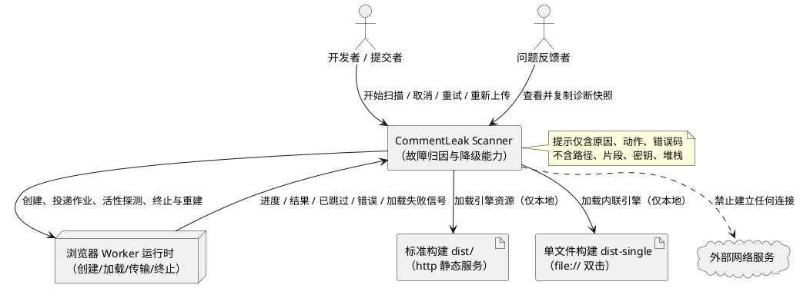
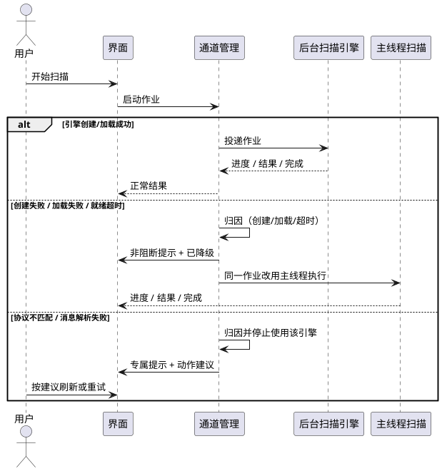
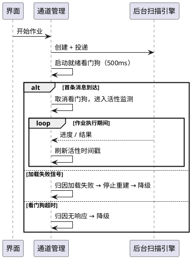
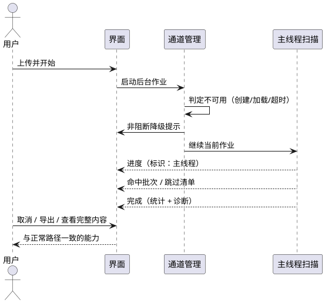
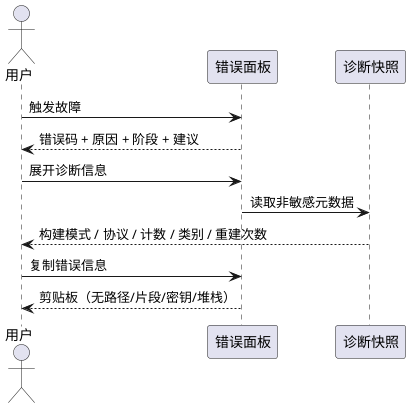

# CommentLeak Scanner 缺陷修复需求规格（EARS）· CLS-E-1008 后台扫描线程通信失败

> **文档状态**：待评审　**版本**：1.0　**日期**：2026-11-12　**需求编号前缀**：CLS
> **缺陷编号**：DEF-CLS-E-1008　**缺陷类型**：运行期故障（浏览器实测失败）　**严重级别**：P0（核心流程不可用）
> **上一阶段文档**：`spec.md`（v1.0，92 条需求）、`design.md`（含 2.6.5 Worker 不可用与降级）、`tasks.md`（4.7 验收断言）
> **本文档范围**：仅缺陷修复需求，不含实现方案、不含源码修改、不含构建动作

---

## 0. 阅读指南

### 0.1 本阶段新增需求编号域

| 前缀 | 业务域 | 说明 |
|---|---|---|
| CLS-ERR | 故障识别与错误呈现 | 故障分类、错误码语义、提示内容与可执行建议 |
| CLS-WRK | 扫描引擎通信健壮性 | 就绪与活性检测、状态原子性、重建退避、消息校验 |
| CLS-DGR | 主线程降级 | 自动降级、降级后能力等价、降级提示 |
| CLS-DIA | 运行诊断 | 仅含非敏感元数据的诊断快照 |
| CLS-NFR-029 ~ 036 | 非功能约束补充 | 故障检测时延、误判约束、一致性、隐私 |
| CLS-PRV-009 / 010 | 隐私约束补充 | 错误链路不泄露、不联网 |
| CLS-ACC-19 ~ 27 | 验收用例补充 | 浏览器实测步骤（含 dist / dist-single / 断网） |

### 0.2 既有需求与本次修复的关系

- `CLS-UIX-004`（错误文案具体化）、`CLS-NFR-009`（后台任务异常必须显示错误码与原因）、`CLS-NFR-021`（错误码 + 原因 + 建议动作）已规定"不得模糊"，但当前实现把**六类不同故障**统一映射为 `CLS-E-1008`，与上述需求实质冲突，本缺陷即为此冲突的暴露。
- `design.md` 2.6.5 已定义"创建后 500ms 无 `job:progress` 且无错误 → 视为不可用 → 降级主线程"，`tasks.md` 4.7 已将其列为验收断言；当前实现**无该逻辑**，属于"设计已定、实现缺失"的缺陷，而非需求新增。
- `tasks.md` 4.6 断言 `onerror/messageerror → CLS-E-1008`，本修复将**收紧**该断言：该映射仅允许作为无法归类时的兜底，不得作为默认路径。此变更需在 `tasks.md` 的下游修订中同步（不在本阶段执行）。

### 0.3 执行摘要（修复需求摘要）

1. **错误归因必须可区分**：将"创建失败 / 脚本加载失败 / 消息解析失败 / 协议版本不匹配 / 作业标识不匹配 / 无响应超时 / 引擎内部错误"拆为独立可识别类别，各自呈现不同错误码与文案；`CLS-E-1008` 仅保留为"无法归类"的兜底。
2. **不可用必须可恢复**：Worker 创建失败、加载失败、就绪超时，一律**自动降级主线程**并在同一作业内完成扫描，用户无需重新上传；降级不得以红色致命错误阻断流程。
3. **提示必须可执行**：每个故障给出至少 1 条**针对该原因**的动作建议（如"刷新页面以更新后台引擎""改用单文件版""关闭拦截扩展"），禁止只写"请重试/刷新"。
4. **故障不得污染后续作业**：任何启动失败（含消息投递失败）必须回滚作业状态，重试不得因残留状态直接报通信故障。
5. **零泄露**：错误态、诊断信息、剪贴板中不得出现文件路径、注释片段、密钥值、异常堆栈、完整 jobId；故障处置链路对外网络请求恒为 0。

---

## 1. 组件定位

### 1.1 核心职责

本次修复负责 **扫描引擎通道的故障归因、恢复与告知**：把"后台扫描线程不可用"从单一不可解释的致命错误，改造为"可分类、可自愈、可操作"的确定性行为。

### 1.2 核心输入

1. **引擎生命周期信号**：Worker 构造结果、脚本加载成功/失败、消息到达、消息解析结果、协议与作业标识、活跃性探测结果。
2. **用户操作**：开始扫描、取消、重新上传、重试、展开诊断信息、复制错误码。
3. **运行环境事实**：构建模式（标准 / 单文件）、页面协议（http / https / file）、浏览器是否支持 Worker 及其安全策略。

### 1.3 核心输出

1. **分类后的故障报告**：类别、错误码、发生阶段、是否可重试、是否已自动恢复（降级）。
2. **恢复行为**：自动降级主线程后的继续扫描（进度、命中、跳过清单、导出全部可用）。
3. **用户提示**：一句原因 + 针对该原因的可执行建议 + 可复制的错误码/诊断编号。
4. **诊断快照**：构建模式、协议版本、通道消息计数、失败类别、重建次数等**非敏感元数据**。

### 1.4 职责边界（不做什么）

- **不修改扫描业务逻辑**：解压、筛选、注释提取、规则匹配、脱敏、导出算法与结果语义不变。
- **不新增网络能力**：不上报、不埋点、不请求远端诊断服务、不引入 CDN。
- **不实现"自动修复文件"或"重试无限次"**：不做无限重建、不做静默循环重试。
- **不改变双构建交付形态**：仍然只交付 `dist/`（http 静态服务）与 `dist-single/index.html`（`file://` 双击）。
- **不以错误信息展示敏感内容换取可诊断性**：宁可诊断信息少，也不泄露路径/片段/密钥。
- **不承诺在所有浏览器 `file://` 下都能使用 Worker**：允许"降级为主线程"作为合法终态。

---

## 2. 领域术语

**扫描引擎（Scan Engine）**
: 承载解压与扫描计算的执行体，既可以是后台线程（Worker），也可以是主线程降级执行；对用户而言是同一能力。

**通道故障（Channel Failure）**
: 主线程与后台扫描线程之间的建立、加载、传输、解析任一环节失败，导致作业无法在该线程继续的总称。

**创建失败（Construct Failure）**
: 浏览器拒绝构造扫描引擎实例（例如不支持 Worker、被安全策略拒绝、构造抛异常）的情形。

**加载失败（Load Failure）**
: 引擎实例已创建，但其执行脚本未能被浏览器成功获取或解析（资源缺失、路径错误、MIME 不正确、语法解析失败、被拦截）的情形。

**消息解析失败（Message Parse Failure）**
: 主线程收到消息但无法按协议解码或校验（消息不可克隆、结构不符、关键字段类型错误）的情形。

**协议版本不匹配（Protocol Mismatch）**
: 收到消息携带的协议版本与当前页面期望不一致，通常由"页面与引擎资源版本不同步"（旧缓存）引起。

**作业标识不匹配（Stale Job Message）**
: 收到的消息属于已结束或不存在的作业；此类消息属于串扰，不得据此判定故障。

**无响应超时（No-Response Timeout）**
: 引擎已创建且未报错，但在约定窗口内无任何有效消息或活性确认，无法确定其是否在工作。

**就绪看门狗（Readiness Watchdog）**
: 从作业启动到收到首条有效消息之间的计时守卫，超时即判定引擎不可用。

**降级（Degradation）**
: 在后台引擎不可用时改用主线程执行同一扫描作业，功能集合不变、性能可能下降。

**重建（Rebuild）**
: 终止当前引擎实例并创建新实例；本修复要求其有次数上限与退避，不得无界发生。

**诊断快照（Diagnostics Snapshot）**
: 一组仅含元数据的运行事实（构建模式、协议版本、消息计数、失败类别、重建次数等），用于用户反馈问题，不含任何扫描内容。

---

## 3. 角色与边界

### 3.1 核心角色

- **开发者 / 提交者**：遇到错误时需要知道"到底是什么坏了、我该做什么"，并要求点击一次即可继续完成扫描。
- **安全审查者 / 评审人**：需要确认错误处理过程本身不泄露被扫描内容。
- **问题反馈者（开发者兼任）**：需要一份不含敏感信息的诊断快照，以便在缺陷跟踪中描述问题。

### 3.2 外部系统与运行环境

- **浏览器 Worker 运行时**：提供引擎实例的创建、脚本加载、消息通道与终止能力；其安全策略（CSP、`file://` 限制、扩展拦截）直接决定可用性。
- **本地静态文件服务（标准构建）**：提供 `dist/index.html` 与 `dist/assets/*`，其路径、缓存与 MIME 行为影响加载成败。
- **本地文件系统（`file://`，单文件构建）**：直接双击 `dist-single/index.html`，无服务端，资源全部内联。
- **外部网络服务**：**不存在调用关系**；故障处置链路亦不得建立任何连接。

### 3.3 交互上下文

---

## 4. DFX 约束（缺陷修复补充）

### 4.1 性能

| 编号 | 约束 | 验证基准 |
|---|---|---|
| CLS-NFR-029 | 从"引擎判定不可用"到"降级路径开始产出首条进度"的间隔 ≤ 1s | Chrome 最新版；DevTools Performance 采样 |
| CLS-NFR-030 | 故障检测不得引入主线程长任务 > 50ms | Performance 面板 Long Task 检查 |
| CLS-NFR-031 | 正常 100MB / 5000 条目包在标准构建下**不得**因看门狗误判降级 | 连续 3 次扫描均全程走后台引擎 |

### 4.2 可靠性

| 编号 | 约束 |
|---|---|
| CLS-NFR-032 | 引擎不可用（创建失败、加载失败、就绪超时）时，当前作业必须以主线程继续并完成，不得要求用户重新上传 |
| CLS-NFR-033 | 任一次启动失败后，后续重试不得因内部状态残留而直接失败；同一会话内重试 3 次仍可用（或稳定降级） |
| CLS-NFR-034 | 同一输入在后台引擎与降级路径下，命中集合、级别、排序、统计与跳过清单必须一致（对齐 CLS-NFR-010） |
| CLS-NFR-035 | 同一故障在一次作业内只向用户呈现一次，不得叠加多个错误面板 |

### 4.3 安全性

| 编号 | 约束 |
|---|---|
| CLS-PRV-009 | 错误态、诊断快照、剪贴板内容中禁止出现：文件路径、注释片段、密钥值、异常堆栈、引擎脚本完整 URL、原始异常消息 |
| CLS-PRV-010 | 故障识别、诊断与降级全过程对外网络请求恒为 0（对齐 CLS-NFR-012） |
| CLS-PRV-011 | 错误文案中允许出现的最大定位信息为"构建模式 + 阶段名 + 错误类别"，不得包含用户机器路径 |

### 4.4 可维护性

| 编号 | 约束 |
|---|---|
| CLS-NFR-036 | 错误码与故障类别必须一一映射，单一来源维护；新增类别不得改动扫描业务逻辑 |
| CLS-NFR-037 | 每个故障类别必须具备可自动化的判定条件（可在无浏览器 GUI 的测试中构造），不得依赖人工观察 |
| CLS-NFR-038 | 通信层（创建、就绪、活性、消息校验、重建、降级）必须有独立于业务扫描的测试覆盖；仅用"直接调用扫描流程"的集成测试不能视为覆盖（对齐 `tasks.md` 4.6/4.7） |

### 4.5 兼容性

| 编号 | 约束 |
|---|---|
| CLS-NFR-039 | 标准构建在 `http(s)` 静态服务下必须可用；单文件构建在 `file://` 双击下必须可用（允许降级） |
| CLS-NFR-040 | 不得要求用户修改浏览器安全设置、不得要求放开 `blob:` / `data:` 的 CSP 才能使用主流程 |
| CLS-NFR-041 | 不支持 Worker 的浏览器必须进入降级路径且全流程可用，不得进入错误态 |

---

## 5. 核心能力

### 5.1 故障识别与分类

#### 5.1.1 业务规则（EARS）

##### CLS-ERR-001 · 故障类别必须可区分 `P0`

**EARS**：If 扫描通道发生故障，then the CommentLeak Scanner shall 将其归入「创建失败 / 加载失败 / 消息解析失败 / 协议版本不匹配 / 无响应超时 / 引擎内部错误 / 无法归类」七类之一，并以与类别一一对应的错误码呈现；**禁止**将上述任一类别默认合并为 `CLS-E-1008`。

**验收标准**

- 构造加载失败（引擎脚本不可获取）→ 显示"加载失败"类专属错误码与文案，**不出现** `CLS-E-1008`。
- 构造协议不匹配 → 显示"版本不一致"类专属错误码，**不出现** `CLS-E-1008`。
- 仅当收到无法归因的异常通道信号时，才允许显示 `CLS-E-1008`，且必须附带原因短语与发生阶段。

##### CLS-ERR-002 · 创建失败不得阻断流程 `P0`

**EARS**：If 浏览器不支持后台扫描线程、或引擎实例构造被拒绝/抛出异常，then the CommentLeak Scanner shall 判定为「创建失败」，自动改用主线程执行当前作业，并以非阻断提示（`CLS-E-4001`）说明性能影响；**禁止**进入致命错误态。

**验收标准**

- 在禁用 Worker 的环境打开页面并上传包 → 显示"已降级为主线程处理"提示，扫描可完整完成，无 `CLS-E-1008`。
- 提示为信息/警告样式（非红色致命错误面板），且不遮挡上传区与进度区。

##### CLS-ERR-003 · 加载失败必须识别并自愈 `P0`

**EARS**：While 作业已启动且引擎尚未产出任何有效消息，If 收到引擎脚本加载失败信号（脚本获取失败、解析失败或被拦截），then the CommentLeak Scanner shall 判定为「加载失败」，终止并停止重建该引擎，改用主线程继续当前作业，并提示"后台扫描引擎未能加载，已切换为主线程处理"及针对该原因的动作建议。

**验收标准**

- 标准构建下删除/重命名 `dist/assets/scan.worker-*.js` 后上传 → 1s 内出现"加载失败 → 已降级"提示，扫描完成且结果与正常路径一致。
- 单文件构建在 `file://` 下若内联引擎被浏览器拒绝 → 同一提示与降级行为，**不得**出现 `CLS-E-1008`。
- 提示中给出至少 1 条动作建议（如"刷新页面""确认构建文件完整""改用另一构建版本"）。

##### CLS-ERR-004 · 消息解析失败不得静默 `P0`

**EARS**：If 主线程收到无法按协议解码的消息（消息不可克隆、结构不符、关键字段类型错误），then the CommentLeak Scanner shall 判定为「消息解析失败」并计数，且在用户可见范围内给出可重试提示；**禁止**静默丢弃后让界面永久停留于"扫描中"。

**验收标准**

- 注入 1 条结构非法的通道消息 → 出现"消息解析失败"提示，可点击"重新尝试"；界面不冻结。
- 连续注入非法消息 50 条 → 只提示一次，诊断快照中"非法消息计数"为 50。

##### CLS-ERR-005 · 协议版本不匹配须明确指向版本同步 `P0`

**EARS**：If 收到的消息携带的协议版本与当前页面不一致，then the CommentLeak Scanner shall 判定为「协议版本不匹配」，提示"页面与后台扫描引擎版本不一致，请刷新页面以更新"并停止使用该引擎；**禁止**将其归为通信失败或静默丢弃。

**验收标准**

- 使用旧版引擎资源（协议版本低 1）触发扫描 → 显示版本不一致专属错误码与"刷新页面"建议。
- 刷新后同一包可正常扫描；再次出现时诊断快照中记录两次不匹配事件。

##### CLS-ERR-006 · 作业标识不匹配属于串扰而非故障 `P0`

**EARS**：If 收到的消息的作业标识与当前活动作业不一致，then the CommentLeak Scanner shall 丢弃该消息仅作计数，**不得**据此判定通道故障、不得展示错误；仅当当前作业在超时窗口内始终没有有效消息时，才允许升级为「无响应超时」。

**验收标准**

- 人为注入 10 条其他作业的进度/结果消息 → 界面无错误提示，当前扫描结果不受影响，诊断快照记录"过期消息 10 条"。
- 注入过期消息后当前作业正常完成 → 不出现任何错误态。

##### CLS-ERR-007 · 并发作业冲突必须语义正确 `P0`

**EARS**：If 已有扫描作业进行中而用户再次提交扫描，then the CommentLeak Scanner shall 以"已有扫描正在进行，请等待完成或先取消"呈现，**禁止**复用通信失败错误码或提示刷新页面。

**验收标准**

- 扫描进行中快速重复触发两次开始 → 第二次提示"已有扫描正在进行"，错误码为状态类而非 `CLS-E-1008`。
- 取消当前作业后立即重新上传 → 可正常开始，不出现任何通信错误。

##### CLS-ERR-008 · 兜底错误码必须携带最小可诊断信息 `P0`

**EARS**：Where 故障无法归入既定类别，the CommentLeak Scanner shall 仍以 `CLS-E-1008` 呈现，但必须附带「发生阶段 + 通道状态短语 + 建议动作」，并保留可复制的错误码；**禁止**只显示"通信失败 + 请重试/刷新"。

**验收标准**

- 人为触发无法归类的通道异常 → 面板显示 `CLS-E-1008 · <原因短语>`，并显示发生阶段（如"引擎就绪阶段"）。
- 提示至少包含 2 条可执行建议（例如"重新上传""刷新页面以更新引擎""展开诊断信息并反馈"）。

#### 5.1.2 交互流程

#### 5.1.3 异常场景

| 场景 | 触发条件 | 系统行为 | 用户感知 |
|---|---|---|---|
| 引擎脚本缺失 | 标准构建 `/assets/scan.worker-*.js` 不可访问 | 归为加载失败，停止重建，降级主线程 | "后台扫描引擎未能加载，已切换为主线程处理" |
| 引擎脚本被拦截 | 扩展/策略阻止 blob、data 或脚本执行 | 归为加载失败并降级 | 同上 + "可尝试关闭浏览器拦截扩展" |
| 版本不同步 | 页面与引擎协议版本不一致 | 归为协议不匹配，停用该引擎 | "页面与引擎版本不一致，请刷新页面" |
| 不可克隆消息 | 通道传输了不可克隆数据 | 归为消息解析失败，计数一次 | "扫描结果传输异常，可重新尝试" |
| 串扰消息 | 作业标识不匹配 | 丢弃并计数，不提示 | 无感知（诊断快照可见） |
| 引擎无响应 | 就绪窗口内无任何消息 | 归为无响应超时，降级主线程 | "后台引擎未响应，已切换为主线程处理" |
| 作业进行中重复提交 | 活动作业未结束 | 拒绝新提交，语义化提示 | "已有扫描正在进行" |

---

### 5.2 扫描引擎通信健壮性

#### 5.2.1 业务规则（EARS）

##### CLS-WRK-001 · 就绪看门狗必须有界 `P0`

**EARS**：When 作业已投递给后台引擎，the CommentLeak Scanner shall 在 **500ms**（阈值由设计阶段最终确认）内等待首条有效消息；If 超时且未收到任何加载失败信号，then the CommentLeak Scanner shall 判定引擎不可用并自动降级主线程，**禁止**无限等待。

**验收标准**

- 人为使引擎"只创建不执行"（不产生任何消息、不报错）→ 500ms（±100ms）内出现降级提示，扫描继续。
- 正常 100MB 包 → 首条进度消息在 500ms 内到达，不触发降级（连续 3 次验证）。

##### CLS-WRK-002 · 作业期间必须具备活性确认 `P0`

**EARS**：While 作业在后台引擎中执行，the CommentLeak Scanner shall 以不超过设计阈值的间隔获得活性确认（进度消息或引擎对活性探测的应答）；If 连续超过阈值无任何活性确认，then the CommentLeak Scanner shall 判定为「无响应超时」并按降级策略处理。

**验收标准**

- 人为冻结引擎（不响应、不发送消息）→ 在阈值（≤ 10s，设计阶段确认）内判定无响应并降级，界面不长时间停留在"扫描中"。
- 100MB 包解压期间（进度间隔 ≤ 200ms）→ 连续 3 次均不被误判为无响应。

##### CLS-WRK-003 · 重建必须有上限且不得空转 `P0`

**EARS**：If 引擎在一次故障后被重建，then the CommentLeak Scanner shall 最多重建 1 次；If 重建后同一作业再次失败或重建本身失败，then the CommentLeak Scanner shall 停止重建并**永久降级至本作业结束**；While 没有活动作业，the CommentLeak Scanner shall **禁止**自动重建引擎。

**验收标准**

- 持续失败的引擎 → 全场只发生 1 次重建，之后稳定运行于主线程，用户仅看到 1 条提示。
- 作业结束/取消后，30s 内不得出现任何自动重建行为（诊断快照重建次数不再增长）。

##### CLS-WRK-004 · 启动失败必须回滚状态 `P0`

**EARS**：If 作业启动过程中的任一步骤失败（消息投递失败、引擎在就绪前被判定不可用、引擎被终止），then the CommentLeak Scanner shall 将当前作业状态完整回滚为"未启动"，保证后续重试不会被残留状态拦截。

**验收标准**

- 人为让消息投递失败 → 首次显示归类后的提示；随后重新上传 → 进入正常或降级流程，**不得**直接显示通信失败。
- 连续 3 次"启动即失败"后重试 → 第 4 次仍可正常开始（或稳定降级），无"刷新才好"的现象。

##### CLS-WRK-005 · 终态消息必须校验作业归属 `P0`

**EARS**：When 收到作业终态消息（完成 / 错误 / 已取消），the CommentLeak Scanner shall 校验其作业标识与当前活动作业一致；If 不一致，then the CommentLeak Scanner shall 丢弃并计数，不得改变当前作业状态。

**验收标准**

- 注入其他作业的"错误"终态消息 → 当前扫描继续，不被置为错误态。
- 注入其他作业的"完成"终态消息 → 当前扫描不被误判完成。

##### CLS-WRK-006 · 非法消息必须有可观测计数 `P0`

**EARS**：If 收到未知类型、字段缺失或校验失败的通道消息，then the CommentLeak Scanner shall 计入诊断快照并保留"最近一次非法消息类别"；**禁止**完全静默地丢弃。

**验收标准**

- 注入 3 类非法消息（未知类型、缺字段、类型错误）→ 诊断快照分别计数，界面不崩溃。
- 诊断快照可复制，且不包含消息正文。

##### CLS-WRK-007 · 同一故障不得重复呈现 `P1`

**EARS**：While 同一作业内已呈现过某类故障提示，If 同类故障再次发生，then the CommentLeak Scanner shall 只更新诊断计数而不新增提示面板。

**验收标准**

- 连续触发 5 次同类加载失败 → 界面仅 1 条提示，诊断快照计数为 5。

##### CLS-WRK-008 · 取消与故障判定不得互相污染 `P0`

**EARS**：When 用户取消作业，the CommentLeak Scanner shall 将取消视为正常结果；If 取消过程中引擎被终止或未及时响应，then the CommentLeak Scanner shall 仍呈现"已取消"，**禁止**呈现任何通道故障错误。

**验收标准**

- 扫描中取消（引擎不响应）→ ≤1s 回到已取消态，无错误码。
- 取消后立即重新上传 → 正常开始，无通信故障提示。

##### CLS-WRK-009 · 引擎不可用时禁止阻断用户输入 `P0`

**EARS**：While 引擎处于不可用或降级状态，the CommentLeak Scanner shall 保持上传、取消、重试、导出入口可用；**禁止**因引擎状态导致按钮永久禁用。

**验收标准**

- 降级状态下完成一次扫描 → 可正常导出 JSON/CSV、可复制路径。
- 错误态下"重新上传"可点击并恢复上传区（不要求刷新页面）。

##### CLS-WRK-010 · 通道能力探测必须反映真实可用性 `P1`

**EARS**：The CommentLeak Scanner shall 以"能否完成一次有效往返"而非"能否构造对象"来判定引擎可用；仅在构造函数未抛错即视为可用，**不满足**本要求。

**验收标准**

- 构造成功但脚本永不执行的场景 → 判为不可用（依赖 CLS-WRK-001/002），不显示"引擎正常"。

#### 5.2.2 交互流程

#### 5.2.3 异常场景

| 场景 | 触发条件 | 系统行为 | 用户感知 |
|---|---|---|---|
| 引擎启动即失败 | 构造成功但脚本不执行 | 看门狗超时 → 降级 | 非阻断提示，扫描继续 |
| 重建后仍失败 | 同一资源持续不可用 | 停止重建，降级至作业结束 | 仅 1 条提示 |
| 无活动作业时引擎报错 | 后台引擎空闲期加载失败 | 记录计数，不重建、不提示 | 无感知 |
| 消息投递失败 | 数据不可传输 | 回滚作业状态，归因提示 | 可重试，不被残留状态阻塞 |
| 取消期引擎终止 | 用户取消 | 呈现已取消 | "已取消本次扫描" |

---

### 5.3 主线程降级

#### 5.3.1 业务规则（EARS）

##### CLS-DGR-001 · 不可用时自动降级并继续当前作业 `P0`

**EARS**：If 引擎被判定为创建失败、加载失败或无响应超时，then the CommentLeak Scanner shall 在不要求用户重新选择文件的前提下，以主线程继续执行**当前作业**并产出完整结果；若因技术约束无法继续当前作业，则必须明确说明"需要重新上传"并保留用户已选文件的再次提交入口（不得要求重新选择文件）。

**验收标准**

- 引擎加载失败 → 扫描进度以"降级"标识继续推进，最终产出命中、跳过清单与统计。
- 用户全程无需重新选择文件；不得出现"请重新上传"作为唯一出路。

##### CLS-DGR-002 · 降级路径的失败必须可见 `P0`

**EARS**：If 主线程降级执行失败（解压异常、解析异常、内部异常），then the CommentLeak Scanner shall 转换为与既有错误目录一致的具体错误态；**禁止**出现界面永久停留在"扫描中"或未处理异常导致的白屏。

**验收标准**

- 人为让降级执行抛出异常 → 出现具体错误码与建议，界面可操作。
- 降级执行 10 次（含 1 次失败）→ 无任何"永久扫描中"现象。

##### CLS-DGR-003 · 降级后能力等价 `P0`

**EARS**：While 运行于降级路径，the CommentLeak Scanner shall 保持进度展示、取消、结果统计、结果表、跳过清单、脱敏展示、二次确认查看、JSON/CSV 导出与路径复制全部可用。

**验收标准**

- 降级完成一次扫描 → 逐项核对上述 9 项能力均可用。
- 同一 zip 在正常路径与强制降级路径各扫一次 → 命中集合、级别、排序、统计、跳过原因分布完全一致。

##### CLS-DGR-004 · 降级提示为非阻断且说明代价 `P0`

**EARS**：When 发生降级，the CommentLeak Scanner shall 以非阻断提示（信息/警告样式）说明"后台扫描不可用、已改为主线程处理、处理大文件时页面可能短暂卡顿"，且不遮挡上传区、进度区与结果区。

**验收标准**

- 提示为单行/两行内联条，不覆盖交互控件；`CLS-E-4001` 可复制。
- 提示出现后仍可点击取消、展开忽略规则、上传新包（作业结束后）。

##### CLS-DGR-005 · 降级决策必须在作业内保持稳定 `P1`

**EARS**：While 已进入降级路径，the CommentLeak Scanner shall 在本作业内不再尝试切回后台引擎，避免抖动与重复提示。

**验收标准**

- 降级作业全程只出现 1 次降级提示，诊断快照中"引擎尝试次数"不再增长。
- 用户开启新作业后，允许重新尝试后台引擎（不得永久禁用）。

##### CLS-DGR-006 · 降级必须留痕但不留内容 `P1`

**EARS**：When 发生降级，the CommentLeak Scanner shall 在诊断快照中记录降级原因类别、发生阶段与时间点；**禁止**记录文件名、路径、片段或内容。

**验收标准**

- 诊断快照含 `降级原因 / 阶段 / 相对时间`，全文检索不到任何文件路径或密钥串。

#### 5.3.2 交互流程

#### 5.3.3 异常场景

| 场景 | 触发条件 | 系统行为 | 用户感知 |
|---|---|---|---|
| 降级后再次失败 | 主线程解压/解析异常 | 转具体错误码 | 具体原因 + 建议 |
| 降级执行被取消 | 用户取消 | 立即停止并释放 | "已取消本次扫描" |
| 降级时大文件卡顿 | 100MB 包 | 保持进度更新与可取消 | 性能提示已提前告知 |
| 降级后新作业 | 用户重新上传 | 新作业可再次尝试后台引擎 | 无额外提示（若成功则不提示） |

---

### 5.4 错误呈现与隐私

#### 5.4.1 业务规则（EARS）

##### CLS-ERR-009 · 提示结构固定为"码 + 因 + 阶段 + 动作" `P0`

**EARS**：When 呈现任何通道类错误，the CommentLeak Scanner shall 同时给出「错误码 / 一句话原因 / 发生阶段 / ≥1 条针对该原因的建议动作」；**禁止**出现只有"请重试""请刷新页面"而无原因与针对性建议的提示。

**验收标准**

- 逐类抽查 7 类故障 → 每类提示均含 4 个要素，且建议动作与类别相关（加载失败→检查/更新引擎资源；版本不一致→刷新；无响应→降级已完成并说明）。
- 提示文案长度 ≤ 120 字（错误码与建议除外），可在 375px 宽度下完整阅读。

##### CLS-ERR-010 · 错误码与诊断编号可复制 `P0`

**EARS**：The CommentLeak Scanner shall 允许用户一键复制"错误码 + 诊断编号 + 诊断快照"，便于缺陷反馈；复制内容不得包含 CLS-PRV-009 禁止项。

**验收标准**

- 点击复制 → 剪贴板内容含错误码与快照，且不含路径/片段/密钥/堆栈。
- 剪贴板不可用时降级为只读文本框（对齐 CLS-EXP-003 既有降级策略）。

##### CLS-PRV-009 · 错误链路禁止泄露 `P0`

**EARS**：The CommentLeak Scanner shall 保证错误态、诊断快照、控制台日志、剪贴板中均不出现文件名/路径、注释片段、密钥值、异常堆栈、完整引擎脚本 URL 与完整作业标识。

**验收标准**

- 在错误态下检索 DOM 文本、复制内容、会话期日志 → 无上述任一内容。
- 引擎脚本定位信息仅以"标准构建 / 单文件构建"与"引擎资源"表述呈现。

##### CLS-PRV-010 · 故障处置零联网 `P0`

**EARS**：The CommentLeak Scanner shall 在故障识别、诊断生成、降级与重试全过程中保持对外网络请求为 0。

**验收标准**

- DevTools Network（保留日志）完成"加载失败 → 降级 → 完成扫描 → 复制诊断"全流程 → 外部请求为 0（仅本地资源）。

#### 5.4.2 交互流程

#### 5.4.3 异常场景

| 场景 | 触发条件 | 系统行为 | 用户感知 |
|---|---|---|---|
| 剪贴板不可用 | `file://` 或权限拒绝 | 展开只读文本框 | 可手动复制 |
| 诊断数据缺失 | 故障发生过早 | 显示已知字段 + "未采集" | 仍有错误码与建议 |
| 日志误入敏感内容 | 开发期调试 | 启动/构建期检查阻断（对齐 CLS-PRV-004） | 不出现于生产 |

---

### 5.5 运行诊断

#### 5.5.1 业务规则（EARS）

##### CLS-DIA-001 · 诊断快照字段受控 `P1`

**EARS**：The CommentLeak Scanner shall 提供可展开的诊断快照，至少包含：构建模式（标准/单文件）、页面协议（http/https/file）、引擎是否可用、引擎来源类型（外部资源/内联）、协议版本号、消息计数（进度/命中/跳过/非法/过期作业）、最近故障类别与阶段、重建次数、是否已降级、作业耗时；**禁止**包含任何内容型字段。

**验收标准**

- 快照字段与上述清单一致，缺失项显示"未采集"。
- 对快照做全文检查 → 不含路径、片段、密钥。

##### CLS-DIA-002 · 诊断快照随错误态可获取 `P1`

**EARS**：While 存在错误态或已降级状态，the CommentLeak Scanner shall 允许用户展开并复制诊断快照；扫描正常完成时可不展示。

**验收标准**

- 错误态与降级态各有"查看诊断信息"入口。
- 复制成功后可粘贴为纯文本，格式稳定可读。

##### CLS-DIA-003 · 诊断不得削弱性能与隐私 `P2`

**EARS**：The CommentLeak Scanner shall 保证诊断采集不引入额外网络请求、不持久化、不在正常路径产生可见日志。

**验收标准**

- 正常扫描期间无新增控制台输出、无存储写入、无网络请求。

#### 5.5.2 交互流程

诊断信息由错误面板内"查看诊断信息"展开，不进入主流程；复制动作见 CLS-ERR-010。

#### 5.5.3 异常场景

| 场景 | 触发条件 | 系统行为 | 用户感知 |
|---|---|---|---|
| 早期失败 | 引擎未创建即失败 | 快照仅含构建模式与协议 | 仍有错误码与建议 |
| 快照过大 | 计数项过多 | 仅输出汇总计数 | 文本 ≤ 40 行 |

---

## 6. 数据约束

> 本章仅约束业务字段语义与取值，不涉及存储结构、类型实现或数据库设计。

### 6.1 故障报告（Failure Report）

1. **错误码**：必填，取值必须来自错误目录；与故障类别一一对应，禁止一对多。
2. **故障类别**：必填，取值为七类之一（创建失败/加载失败/消息解析失败/协议不匹配/无响应超时/引擎内部错误/无法归类）。
3. **发生阶段**：必填，取值为业务阶段名（如"引擎就绪""解压""扫描""终态传输"）。
4. **是否可重试**：必填，布尔语义；加载失败与协议不匹配（在未刷新前）应为不可重试直至环境更新。
5. **是否已恢复**：必填，表示是否已通过降级继续；已降级时错误不得为致命阻断态。
6. **原因短语**：必填，长度 ≤ 40 字，不得包含路径、片段、密钥、堆栈。
7. **建议动作**：必填，≥1 条，且必须与本类别强相关。

### 6.2 诊断快照（Diagnostics Snapshot）

1. **构建模式**：必填，取值为"标准构建 / 单文件构建"。
2. **页面协议**：必填，取值为"http / https / file"。
3. **引擎可用性**：必填，布尔。
4. **引擎来源类型**：必填，取值为"外部资源 / 内联资源 / 无"。
5. **协议版本号**：必填，数值。
6. **消息计数**：必填，至少含进度、命中、跳过、非法、过期作业五类计数，非负整数。
7. **失败类别与阶段**：可选，存在故障时必填。
8. **重建次数**：必填，非负整数。
9. **降级状态**：必填，布尔。
10. **作业耗时**：可选，毫秒。
11. **禁止字段**：任何文件名、路径、片段、密钥、堆栈、完整作业标识、引擎脚本完整地址。

### 6.3 错误目录条目（Error Catalog Entry）

1. **错误码**：全局唯一，`CLS-E-xxxx` 格式。
2. **类别**：必须属于 6.1 的七类之一。
3. **文案**：一句原因，≤ 60 字，全中文。
4. **建议**：≥1 条动作，≤ 80 字，可执行、可验证。
5. **阻断性**：必须明确为"阻断（需用户动作）"或"非阻断（已自动恢复）"；降级相关条目必须为非阻断。

---

## 7. 验收用例（浏览器实测）

> 前置：使用项目既有夹具 `fixtures/acceptance.zip`（或等价小包）与 `fixtures/large-many.zip`。本阶段不执行构建，以下步骤由测试阶段执行。

| 编号 | 环境 / 前置 | 操作步骤 | 预期结果 | 对应需求 | 级别 |
|---|---|---|---|---|---|
| CLS-ACC-19 | 标准构建，`npx serve dist`（或任一静态服务） | 打开页面 → 上传 `acceptance.zip` → 等待完成 | 无任何 `CLS-E-1008`；进度经解压/筛选/扫描/完成；结果与既有基线一致 | CLS-ERR-001、CLS-NFR-031 | P0 |
| CLS-ACC-20 | 标准构建，静态服务 | 重命名 `dist/assets/scan.worker-*.js`（模拟资源缺失）后上传 | 1s 内出现"加载失败 → 已降级"非阻断提示；扫描在主线程完成；**不出现** `CLS-E-1008` | CLS-ERR-003、CLS-DGR-001、CLS-NFR-029 | P0 |
| CLS-ACC-21 | 单文件构建，双击 `dist-single/index.html`（`file://`） | 上传 → 扫描 → 导出 | 若内联引擎可用则正常完成；若被浏览器拒绝则 ≤1s 自动降级并完成；全程无阻断性 `CLS-E-1008`；Network 面板无外部请求 | CLS-ERR-002、CLS-ERR-003、CLS-DGR-001/004、CLS-NFR-039/040 | P0 |
| CLS-ACC-22 | 任一构建，DevTools 勾选 Offline | 上传 → 扫描 → 导出 JSON/CSV → 复制路径 | 全流程可用；Network 无外部请求；无版本相关错误 | CLS-PRV-010、CLS-NFR-039 | P0 |
| CLS-ACC-23 | 标准构建，保留旧版 `scan.worker-*.js` 并让页面加载新版（或人工将消息协议版本改为 0） | 上传 → 扫描 | 显示"页面与引擎版本不一致，请刷新页面"专属错误码；刷新后可正常扫描；**不出现** `CLS-E-1008` | CLS-ERR-005、CLS-WRK-010 | P0 |
| CLS-ACC-24 | 任一构建，在测试桩中注入结构非法的通道消息 | 触发扫描并注入 1 条非法消息、10 条过期作业消息 | 非法消息 → "消息解析失败"可重试提示且仅 1 条；过期消息 → 无提示、结果不受影响；诊断快照计数分别为 1 与 10 | CLS-ERR-004/006、CLS-WRK-005/006 | P0 |
| CLS-ACC-25 | 任一构建 | 扫描中快速重复点击/重复提交开始；随后取消并立即重新上传 | 重复提交提示"已有扫描正在进行"（状态类错误码）；取消后 ≤1s 可重新开始；全程无通信故障提示 | CLS-ERR-007、CLS-WRK-008/004 | P0 |
| CLS-ACC-26 | 任一构建，进入错误态与降级态 | 检索 DOM 文本、复制的错误信息、诊断快照、控制台、剪贴板、Application 存储 | 均无文件路径、注释片段、密钥、堆栈、完整 jobId；Network 0 请求 | CLS-PRV-009/010、CLS-DIA-001 | P0 |
| CLS-ACC-27 | 任一构建 | 同一 zip：（A）正常后台扫描；（B）强制降级扫描 | 两次的命中集合、级别、排序、统计、跳过原因分布完全一致 | CLS-DGR-003、CLS-NFR-034 | P0 |
| CLS-ACC-28 | 标准构建，100MB / 5000 条目包 | 连续扫描 3 次，观察诊断快照 | 3 次均未触发看门狗/降级；首条进度 ≤500ms；最长消息静默期未触发无响应判定 | CLS-NFR-031、CLS-WRK-001/002 | P0 |
| CLS-ACC-29 | 浏览器禁用 Worker（或使用不支持 Worker 的环境） | 打开页面并上传 | 立即非阻断提示 `CLS-E-4001`；全流程扫描与导出可用；无 `CLS-E-1008` | CLS-ERR-002、CLS-NFR-041 | P1 |

---

## 8. 需求追踪矩阵

| 修复主题 | 需求编号 | 条目数 | 涉及既有文档章节 | 验收用例 |
|---|---|---|---|---|
| 故障识别与分类 | CLS-ERR-001 ~ 008 | 8 | `design.md` 2.6.5、`tasks.md` 4.6/4.7 | ACC-19/20/23/24/25 |
| 错误呈现与隐私 | CLS-ERR-009/010、CLS-PRV-009/010/011 | 5 | `spec.md` CLS-UIX-004、CLS-NFR-021、CLS-PRV-004 | ACC-26 |
| 通信健壮性 | CLS-WRK-001 ~ 010 | 10 | `design.md` 2.6.1/2.6.4/2.6.6 | ACC-23/24/25/28 |
| 主线程降级 | CLS-DGR-001 ~ 006 | 6 | `design.md` 2.6.5、`tasks.md` 4.7 | ACC-20/21/27/29 |
| 运行诊断 | CLS-DIA-001 ~ 003 | 3 | `design.md` 2.6.6 | ACC-24/26 |
| 非功能补充 | CLS-NFR-029 ~ 041 | 13 | `spec.md` CLS-NFR-001 ~ 028 | ACC-19/20/22/28 |

**合计**：本次新增/修订 45 条，其中 P0 36 条、P1 8 条、P2 1 条。

---

## 9. 范围外事项（Non-Goals）

- 不修改扫描算法、规则集、脱敏策略与导出格式。
- 不对既有 `CLS-E-1001 ~ 1010`、`CLS-E-2001/2002`、`CLS-E-3001/3002` 的语义做重新定义（仅新增/细分通道类）。
- 不提供在线错误上报、不采集浏览器指纹、不增加任何遥测。
- 不为特定静态服务器编写配置（MIME/缓存策略由部署方负责）。
- 不承诺修复浏览器自身的 `file://` Worker 限制，只承诺"可检测 + 可降级 + 可解释"。

---

## 10. 假设、根因假设与风险

### 10.1 前提假设

| 类别 | 内容 | 应对 |
|---|---|---|
| 假设 | 用户使用支持 Web Worker 的现代浏览器（CLS-NFR-023 范围内） | 不支持时降级（CLS-NFR-041） |
| 假设 | 标准构建经 `http(s)` 访问，单文件构建经 `file://` 双击访问 | 两种环境均纳入验收 |
| 假设 | 既有 99 条测试全部为 Node 环境，未跨越真实 Worker 边界 | 本修复要求补充通道层测试（CLS-NFR-038） |
| 依赖 | 浏览器 `Worker`、`Blob`、消息通道与终止能力 | 不可用时降级 |

### 10.2 根因假设（静态分析结论，未在浏览器复现）

详细证据与验证方法见 **附录 B**。结论排序：

| 排序 | 假设 | 置信度 | 说明 |
|---|---|---|---|
| H1（架构性，确定存在） | 所有通道异常统一映射为 `CLS-E-1008`，且就绪看门狗/活性探测缺失，用户无法区分与自愈 | 高（代码可证） | 这是"任何故障都长成同一错误"的直接原因，也是"提示只能让你重试/刷新"的原因 |
| H2（环境性） | 单文件构建 `file://` 下内联引擎被浏览器拒绝，且降级守卫未实现 | 中高 | 与"浏览器实测失败、设计文档已预警"高度吻合 |
| H3（环境性） | 标准构建下引擎资源不可获取（缓存旧页面对应已删除的 hash 文件、部署子路径、MIME 不正确、扩展拦截） | 中高 | 产物引用形式依赖资源路径可访问性 |
| H4（状态性） | 启动阶段失败后作业状态未回滚，导致后续每次提交直接报通信失败，刷新后恢复 | 中高 | 与"反复出现、刷新页面可尝试"的描述一致 |
| H5（版本性） | 旧缓存引擎与当前页面协议不一致，被直接归为通信失败 | 中 | 协议守卫存在但归因错误 |
| H6（传输性） | 不可克隆消息触发解析失败并被归为通信失败 | 低 | 当前协议载荷均为可克隆数据结构 |
| H7（引擎内部） | 引擎内真实未捕获异常（内存压力下解压/正则） | 中低 | 大包场景需专项验证 |
| H8（交付性） | 浏览器运行的是旧 `dist`（构建产物未更新或缓存） | 中低 | 需在复现第一步排除 |

### 10.3 风险

| 风险 | 影响 | 应对 |
|---|---|---|
| 看门狗阈值过小 | 正常大包被误判降级，性能下降 | 阈值需覆盖"合法最长静默期"，并以活性确认区分（开放问题 Q2） |
| 降级需重投数据 | zip 字节可能已被转移，无法直接在主线程复用 | 设计阶段决策（开放问题 Q3） |
| 新增错误码过多 | 用户理解成本上升 | 文案必须以"原因 + 动作"为主，错误码为辅 |
| 诊断快照被误当内容载体 | 隐私承诺受损 | 字段白名单 + 验收检索（ACC-26） |

---

## 11. 变更记录

| 版本 | 日期 | 变更内容 |
|---|---|---|
| 1.0 | 2026-11-12 | 首次发布：针对 `CLS-E-1008` 运行期故障的缺陷修复需求规格，新增 CLS-ERR / CLS-WRK / CLS-DGR / CLS-DIA 四个需求域 |

---

## 附录 A · 现有实现的触发路径清单（分析证据，非需求）

> 说明：以下为对当前源码与产物的静态核查结果，用于支撑需求归因；本阶段未修改任何源码、未执行构建。行号以当前工作区为准。

### A.1 统一故障出口（单一映射点）

| 编号 | 位置 | 现有行为 | 是否可分类 | 用户可见结果 |
|---|---|---|---|---|
| P-01 | `src/workers/workerClient.ts` `handleWorkerFailure()`（约 179–189 行） | 无条件 `terminate` + 重置作业 + 回调固定 `CLS-E-1008` 文案 | 否 | 红色致命错误 + "重新上传/刷新" |
| P-02 | 同上，`bindWorker()` 的 `worker.onerror`（约 125–127 行） | 引擎脚本加载失败、解析失败、**引擎内未捕获异常**全部进入 P-01 | 否 | 同上 |
| P-03 | 同上，`worker.onmessageerror`（约 128–130 行） | 不可克隆/解码失败进入 P-01 | 否 | 同上 |
| P-04 | `src/workers/protocol.ts` `isProtocolMismatch()`（约 138–140 行）+ `workerClient.handleMessage()`（约 134–137 行） | 任意 `protocol` 不等于当前版本的对象 → P-01 | 否（与通信故障混同） | 同上 |

### A.2 非故障被当作故障（语义错误）

| 编号 | 位置 | 现有行为 | 触发条件 | 用户可见结果 |
|---|---|---|---|---|
| P-05 | `workerClient.start()`（约 58–60 行） | 活动作业未结束时 `throw new ClsError('CLS-E-1008')` | 作业未正常复位时再次提交（快速重复点击、取消与重试竞态） | 报告"后台扫描线程通信失败" |
| P-06 | `src/ui/hooks/useScanJob.ts` `failureFrom()` | 将上述错误转换为 1008 文案与"重试/刷新"建议 | 同 P-05 | 同上 |

### A.3 静默丢弃与静默挂起（无错误、但有缺陷）

| 编号 | 位置 | 现有行为 | 触发条件 | 用户可见结果 |
|---|---|---|---|---|
| P-07 | `workerClient.handleMessage()`（约 138 行） | `isWorkerResponse` 校验失败 → 直接 `return`，无计数、无提示 | 未知类型、字段缺失、类型错误 | 界面可能永久"扫描中" |
| P-08 | 同上（progress/findings/skipped/done/cancelled 分支） | 作业标识不匹配 → 静默丢弃（符合 CLS-ERR-006 方向，但无计数） | 过期/串扰消息 | 无感知（无诊断可查） |
| P-09 | 同上 `case 'job:error'`（约 163–167 行） | **不校验作业标识**，任意错误终态都会清空当前作业并置错误态 | 旧作业错误、串扰错误 | 当前作业被误终止 |
| P-10 | `useScanJob.ts` `handleResponse` `job:done` 分支 | 若累计配置为空 → `return`，不更新状态 | 终态早于配置登记（异常时序） | 永久"扫描中" |
| P-11 | `scan.worker.ts`（约 28–30 行） | 收到 `job:ping` 直接 `return`，不做任何应答 | 任何活性探测 | 无法判断引擎是否"活着"；`design.md` 2.6.2 约定"ping 回 progress"未实现 |

### A.4 生命周期与重建缺陷

| 编号 | 位置 | 现有行为 | 风险 |
|---|---|---|---|
| P-12 | `workerClient.terminateWorker()`（约 191–205 行） | 终止后**无条件**尝试重建；`handleWorkerFailure()` 每次都调用它 | 持续失败时反复重建；无活动作业时也会重建；无退避/上限 |
| P-13 | `workerClient.start()`（约 68–75 行） | 先置 `activeJobId`，再 `postMessage`，**未捕获投递异常** | 投递失败（如数据不可传输）→ 作业状态残留 → 后续每次提交命中 P-05 |
| P-14 | `workerClient.cancel()`（约 95–101 行） | 800ms 定时器到点 `terminate` + 重建 | 取消路径同样触发 P-12 |
| P-15 | `useScanJob.runFallback()`（`await runJob(...)`）与 `start()` 中 `void runFallback(...)` | 降级执行**无 try/catch** | 主线程执行异常 → 未处理拒绝 → 永久"扫描中" |
| P-16 | `useScanJob` 初始化（`useEffect`） | 仅在构造时判断 `client.supported`，无"是否真正可用"的往返验证 | 构造成功即视为可用（违反 CLS-WRK-010） |

### A.5 构建与产物侧触发条件

| 编号 | 位置 / 产物证据 | 事实 | 可能的失败条件 |
|---|---|---|---|
| P-17 | `src/workers/factory.standard.ts` | `new Worker(new URL('./scan.worker.ts', import.meta.url), { type: 'classic' })` | 依赖独立引擎资源可被浏览器获取 |
| P-18 | `dist/assets/index-*.js`（现产物） | 生成 `new URL('scan.worker-BJXQPVr2.js', import.meta.url)` 形式引用；`dist/assets/scan.worker-BJXQPVr2.js` 存在（约 213KB，IIFE） | 资源被删除/替换成不同 hash（旧页面 + 新产物）、子路径部署、MIME 非脚本、扩展拦截 → 加载失败 |
| P-19 | `src/workers/factory.inline.ts` | `import ... from './scan.worker?worker&inline'` | 依赖浏览器允许内联引擎 |
| P-20 | `dist-single/index.html`（现产物） | 引擎以 base64 内联（解码后 213049 字节，与标准产物长度一致），经 `Blob` URL 创建，失败时回退 `data:` URL，并在 `finally` 中立即 `revokeObjectURL` | `file://` 页面下 Blob/data 引擎可能被安全策略拒绝；立即撤销存在竞态窗口；两者皆失败时只能依赖降级（当前缺失） |
| P-21 | `scripts/verify-build.mjs` | 仅检查 HTML 中存在 `Blob|worker` 关键字 | 静态校验通过 ≠ 浏览器可运行；无法发现"能构造但脚本不执行" |
| P-22 | `src/workers/__tests__/jobRunner.integration.test.ts` | 直接调用 `runJob`，不经 `Worker` 边界 | 通信层（创建/加载/超时/消息校验/重建/降级）测试覆盖为 0，解释了"99 条测试全过但浏览器失败" |
| P-23 | `design.md` 2.6.5 与 `tasks.md` 4.7 | 已要求"创建后 500ms 无 `job:progress` 且无错误 → 降级" | 当前 `workerClient.ts` 中除取消 800ms 外**无任何定时守卫**，实现缺失 |

### A.6 触发条件矩阵（环境 × 阶段）

| 环境 | 阶段 | 可能的失败原因 | 现有呈现 |
|---|---|---|---|
| 标准构建 + http | 引擎创建 | 构造抛错（策略/扩展） | 降级（`CLS-E-4001`，符合预期） |
| 标准构建 + http | 引擎加载 | 资源 404 / 旧 hash / MIME / 拦截 | `CLS-E-1008`（无归因、无降级） |
| 标准构建 + http | 就绪 | 引擎脚本不执行、空闲期失败 | 静默等待或 `CLS-E-1008` |
| 标准构建 + http | 传输 | 非法消息、不可克隆 | `CLS-E-1008` |
| 单文件 + `file://` | 引擎创建/加载 | Blob 被拒、data 被拒、立即撤销竞态 | `CLS-E-1008` 或永久扫描中（降级缺失） |
| 任一环境 | 作业复用/重试 | 状态残留、重复提交 | `CLS-E-1008`（复用错误码） |
| 任一环境 | 取消 | 引擎未响应 | 正常取消（符合预期，但会触发重建 P-12） |

---

## 附录 B · 根因假设排序与验证方法

> 全部为静态分析与产物取证结论，**尚未在真实浏览器复现**；验证方法已转化为第 7 章验收用例。

### B.1 排序与判定依据

**H1 · 归因架构缺陷（确定存在，置信度高）**

- 依据：P-01/P-02/P-03/P-04 表明四类不同故障共用同一出口；P-05 表明非故障状态也复用同码。
- 判定：满足"用户报告任何情况下都看到同一句提示"的表层特征。
- 验证：ACC-20/23/24（构造指定原因，检查是否仍出现 1008）。
- 修复归属：CLS-ERR-001/003/004/005/007/008。

**H2 · 单文件 `file://` 下内联引擎不可用（置信度中高）**

- 依据：P-20（Blob → data 兜底 → 立即撤销）；`design.md` 2.6.5 已将"`file://` 下 Blob Worker 被拒"列为已知场景；P-23 表明对应降级守卫未实现。
- 判定：若用户在"双击单文件版"场景下必现，则本假设成立。
- 验证：ACC-21（分浏览器记录：引擎是否被拒、是否降级）。
- 修复归属：CLS-ERR-002/003、CLS-DGR-001、CLS-NFR-039/040。

**H3 · 标准构建引擎资源不可获取（置信度中高）**

- 依据：P-18（引用独立 hash 资源）；缓存旧页面 + 新产物、子路径部署、MIME、拦截均可导致 P-02。
- 判定：若"清缓存/换端口重开"后恢复，则本假设成立。
- 验证：ACC-20（删除资源）+ ACC-19（正常回归）；另记录静态服务器与访问路径。
- 修复归属：CLS-ERR-003、CLS-DGR-001、CLS-ERR-009（提示需指向"检查构建文件完整性/刷新"）。

**H4 · 状态残留导致持续性失败（置信度中高）**

- 依据：P-13（投递失败未捕获）+ P-05（残留状态即报 1008）；P-12（重建无上限）。
- 判定：若"刷新页面后首次可用、后续又坏"或"必须刷新才能再试"，则本假设成立。
- 验证：ACC-25（重复提交/取消后重试）、CLS-WRK-004 的验收断言。
- 修复归属：CLS-WRK-003/004、CLS-ERR-007。

**H5 · 协议版本不匹配（置信度中）**

- 依据：P-04（mismatch 直接 1008）；旧页面缓存引用旧引擎资源时可触发。
- 判定：若"强制刷新（绕过缓存）后恢复"，则本假设成立。
- 验证：ACC-23。
- 修复归属：CLS-ERR-005。

**H6 · 不可克隆消息（置信度低）**

- 依据：P-03；当前协议载荷均为可克隆结构（对象/数组/字符串/ArrayBuffer），风险较低。
- 验证：ACC-24 的注入桩。
- 修复归属：CLS-ERR-004。

**H7 · 引擎内部未捕获异常（置信度中低）**

- 依据：P-02 无法区分"加载失败"与"运行期崩溃"；jszip 解压与正则匹配在内存压力下存在抛出可能。
- 判定：若仅在 100MB 大包或特定 zip 上出现，则本假设成立。
- 验证：ACC-28 + 大包重复扫描；诊断快照区分"加载失败"与"引擎内部错误"。
- 修复归属：CLS-ERR-001（引擎内部错误单独归类）、CLS-ERR-008。

**H8 · 运行的是旧产物（置信度中低）**

- 依据：本地开发常见；`dist` 与 `dist-single` 构建时间戳与浏览器缓存不一致即可触发 P-18 的 hash 失配。
- 验证：复现第一步清缓存/换无痕窗口，记录产物 hash 与构建时间。
- 修复归属：CLS-ERR-003 的"版本同步"建议动作。

### B.2 为什么"99 条测试全过但浏览器失败"

- P-22 表明集成测试直接调用扫描流程，绕过 Worker 边界；通信层的"创建、加载、就绪、活性、消息校验、重建、降级"零覆盖。
- P-21 表明构建校验只做静态关键字检查，无法证明引擎在目标环境可加载。
- 因此本修复的验收必须以**真实浏览器 + 两种构建 + 断网**为准（第 7 章），不得以 Node 测试通过作为修复完成的依据（CLS-NFR-038）。

---

## 附录 C · 需设计阶段决策的开放问题

| 编号 | 问题 | 影响 | 建议决策方向 |
|---|---|---|---|
| Q1 | 新错误码如何分配？（新增 `CLS-E-1011 ~ 1018`，还是保留 1008 并增加"原因子码"） | 影响错误目录、UI 文案、既有测试断言、README 错误码表 | 倾向新增独立错误码，保证"一类一码"（CLS-NFR-036） |
| Q2 | 就绪看门狗与无响应阈值取多少？如何区分"合法长静默"（大包解压/同步正则）与"引擎已死"？ | 误判降级风险 vs 用户等待时长 | 就绪 500ms 起步；活性确认需协议支持（新增应答消息），阈值不早于最长合法静默期 |
| Q3 | 降级时如何取得当前作业的数据？zip 字节若以转移方式交付给引擎，主线程已不可复用 | 决定"无需重新上传"能否成立（CLS-DGR-001） | 保留文件引用/不转移/或降级时请求重新读取；需评估内存代价 |
| Q4 | 是否允许"自动重试一次再降级"？ | 影响用户体验与实现复杂度 | 倾向加载失败直接降级；运行期崩溃可重试 1 次 |
| Q5 | 协议是否升级为 v2（新增活性应答/引擎就绪握手）？旧缓存引擎如何识别与提示？ | 影响兼容性与版本策略 | 建议引入就绪握手 + 版本不匹配专属提示 |
| Q6 | 诊断快照是否允许"下载本地文件"？是否属于既有隐私边界内？ | 影响反馈效率与隐私承诺 | 允许复制；下载需评估是否新增"文件写出"能力 |
| Q7 | 构建校验是否增加"引擎资源存在且可被引用"的检查？ | 影响 CI 能否提前发现加载类问题 | 建议增加资源存在性/引用一致性校验 |
| Q8 | 不同浏览器（Chrome/Edge/Firefox/Safari）在 `file://` 下的内联引擎行为差异，是否影响文案与默认策略？ | 影响兼容性验收口径 | 以"实测矩阵 + 统一降级"为准，不在文案中承诺特定浏览器可用 |
| Q9 | 是否需要在降级时调整性能相关承诺（CLS-NFR-001/003 为主线程降级是否仍然成立）？ | 影响验收口径 | 建议明确"降级态性能不适用后台线程指标，但必须可取消、进度可见" |

---

## 附录 D · 待用户确认事项

1. **错误码策略**：是否接受"新增 6~7 个独立错误码 + 1008 仅兜底"（Q1），还是要求保留单一 1008 并加子原因（改动更小但可读性差）。
2. **降级是否必须"无需重新上传"**：若技术约束导致必须重新选择文件，是否可接受"保留再次提交入口 + 明确说明"。
3. **看门狗阈值**：启动静默 500ms 是否沿用设计文档；无响应阈值取 5s / 8s / 10s 中的哪一个。
4. **单文件 `file://` 的验收口径**：若浏览器确实拒绝内联引擎，是否将"自动降级并完成扫描"作为通过标准（而非要求 Worker 必须可用）。
5. **诊断信息边界**：是否允许把诊断快照导出为本地文件（Q6），或仅允许复制到剪贴板。
6. **是否同步修订上游文档**：`tasks.md` 4.6 中"onerror/messageerror → CLS-E-1008"的断言与本修复冲突，是否在本阶段之后由任务阶段统一修订。